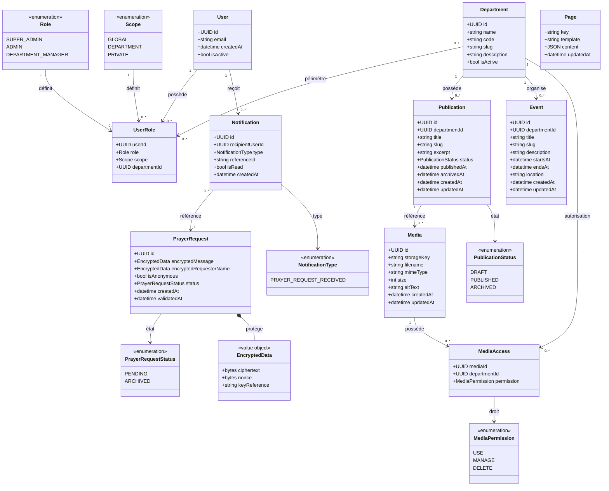

# CCJV — Modélisation statique UML du backend

**Projet :** Centre Chrétien Jésus ma Vie (CCJV)  
**Phase :** Phase 3 — COMMENT / 3.2 Modélisation dynamique & statique  
**Livrable :** Diagramme de classes métier  
**Statut :** Modèle de conception — pré-GEL

---

## 1. Objectif

Ce document transforme le modèle métier en une **modélisation statique UML**.

Le diagramme décrit les objets métier persistants ou structurants, leurs responsabilités et leurs relations.

Il ne constitue pas encore le schéma SQL définitif.

Les choix qui restent ouverts dans le modèle métier sont explicitement signalés, notamment la possibilité d'événements globaux et le mécanisme cryptographique des demandes de prière.

---

# 2. Diagramme de classes métier



---

# 3. Lecture du modèle

## 3.1. User / Role / Scope

Le modèle sépare volontairement :

- **User** : identité/authentification ;
- **Role** : capacité métier générale ;
- **Scope** : périmètre d'action ;
- **Department** : périmètre organisationnel concret.

La combinaison est donc conceptuellement :

```text
User
  └── UserRole
        ├── Role
        ├── Scope
        └── Department (si scope = DEPARTMENT)
```

Exemple :

```text
Utilisateur : Jean
Role       : DEPARTMENT_MANAGER
Scope      : DEPARTMENT
Department : PRESSE
```

Jean peut donc exercer les capacités de responsable de département, mais uniquement sur Presse.

---

# 4. Département

`Department` est une entité centrale du modèle.

Elle sert notamment à :

- identifier une unité organisationnelle ;
- rattacher les publications ;
- rattacher les événements départementaux ;
- définir le périmètre des responsables ;
- contrôler les autorisations d'utilisation de certains médias.

Exemples de données :

```text
PRESSE
ECODUME
AFFAIRES-SOCIALES
```

Le code métier d'un département ne doit pas remplacer son identité persistée.

---

# 5. Publication

La relation principale est :

```text
Department 1 ─────── 0..* Publication
```

Une publication appartient obligatoirement à un département.

La publication possède son propre cycle :

```text
DRAFT
  │
  ▼
PUBLISHED
  │
  ▼
ARCHIVED
```

Le passage `PUBLISHED → ARCHIVED` est déclenché par la règle métier des trois dernières publications.

### Contrainte importante

L'état `ARCHIVED` est persistant.

Il ne s'agit pas d'un statut calculé uniquement à partir de la date.

---

# 6. Événement

La relation actuellement modélisée est :

```text
Department 1 ─────── 0..* Event
```

Cela correspond au modèle départemental.

Cependant, le modèle métier laisse encore ouverte la question suivante :

> Un événement peut-il être global à l'église et donc ne posséder aucun département ?

Si cette décision est confirmée, la cardinalité deviendra :

```text
Department 0..1 ─────── 0..* Event
```

Cette décision doit être arrêtée avant le GEL.

Le statut temporel d'un événement n'est pas assimilé au statut d'une publication.

---

# 7. Média et MediaAccess

C'est un point central du modèle.

Il n'existe pas de relation :

```text
Media → Department
```

au sens d'une appartenance exclusive.

Le modèle est :

```text
                 ┌───────────────┐
                 │     Media     │
                 └───────┬───────┘
                         │
                  0..* MediaAccess
                         │
                         ▼
                 ┌───────────────┐
                 │  Department   │
                 └───────────────┘
```

Un même média peut donc être utilisable par plusieurs départements.

Exemple :

```text
media-001
   ├── Presse
   └── Ecodume
```

ou :

```text
media-002
   └── Ecodume
```

Le modèle distingue les droits :

```text
USE
MANAGE
DELETE
```

Cette distinction devra être affinée dans le RBAC technique.

---

# 8. Relation Publication / Media

Une publication peut référencer plusieurs médias :

```text
Publication 1 ─────── 0..* Media
```

Le backend doit appliquer l'invariant :

```text
Publication.department
        ↓
MediaAccess
        ↓
autorisation USE
```

Donc :

> Une publication ne peut référencer qu'un média utilisable par son département.

Cette règle ne doit pas être déléguée au frontend.

---

# 9. Page éditoriale

`Page` représente le conteneur éditorial structuré.

Elle ne doit pas être interprétée comme un page builder.

Conceptuellement :

```text
Page
 ├── key
 ├── template
 └── content JSON
```

Le `content` contient uniquement les structures autorisées par le template.

Le code contrôle :

- le template ;
- les sections disponibles ;
- les variantes ;
- les champs attendus ;
- le rendu ;
- le responsive ;
- les contraintes visuelles.

La donnée éditoriale fournit les valeurs.

---

# 10. PrayerRequest

`PrayerRequest` est volontairement séparée du modèle de contenu classique.

Elle appartient à un périmètre :

```text
Scope = PRIVATE
Audience = ADMIN
```

Son cycle est :

```text
PENDING
   │
   │ validation par ADMIN
   ▼
ARCHIVED
```

L'archivage conserve la donnée.

---

# 11. Protection cryptographique

Le champ sensible de `PrayerRequest` n'est pas modélisé comme une simple chaîne :

```text
string message
```

mais comme une donnée chiffrée :

```text
EncryptedData
```

Cela représente le besoin métier de séparer :

- le contenu chiffré ;
- les métadonnées cryptographiques ;
- le mécanisme de gestion des clés.

Le détail cryptographique n'est volontairement pas fixé par le diagramme métier.

La contrainte métier est :

> le Super Admin ne doit pas pouvoir obtenir le contenu en clair d'une demande de prière.

Le choix concret du protocole et de la gestion des clés appartient à la conception technique.

---

# 12. Notification

Une nouvelle demande de prière produit une notification destinée aux Admins.

Le modèle :

```text
PrayerRequest
       │
       ▼
Notification
       │
       ▼
Admin User
```

La notification référence la demande mais ne doit pas recopier son contenu sensible.

Elle peut par exemple porter :

```text
type = PRAYER_REQUEST_RECEIVED
referenceId = <id de la demande>
```

L'interface Admin pourra ensuite demander l'accès à la demande selon la politique de confidentialité.

---

# 13. Agrégats métier proposés

Pour préparer la conception logicielle, les objets peuvent être regroupés en agrégats.

## Agrégat Administration

Racine :

`User`

Objets associés :

- UserRole
- Role
- Scope

Responsabilité :

- identité ;
- rôle ;
- périmètre.

---

## Agrégat Département

Racine :

`Department`

Objets associés :

- responsables ;
- publications ;
- événements selon les règles métier.

Responsabilité :

- organisation ;
- périmètre départemental.

---

## Agrégat Publication

Racine :

`Publication`

Objets associés :

- références médias.

Responsabilité :

- cycle éditorial ;
- rattachement départemental ;
- publication ;
- archivage.

---

## Agrégat Média

Racine :

`Media`

Objet associé :

- MediaAccess.

Responsabilité :

- bibliothèque centrale ;
- droits d'utilisation.

---

## Agrégat Page éditoriale

Racine :

`Page`

Responsabilité :

- contenu éditorial structuré ;
- respect du template.

---

## Agrégat Prière

Racine :

`PrayerRequest`

Objets associés :

- EncryptedData ;
- Notification comme conséquence métier.

Responsabilité :

- réception ;
- confidentialité ;
- validation ;
- archivage.

---

# 14. Contraintes UML à conserver

Les cardinalités importantes sont :

```text
User 1 ───── 0..* UserRole

Department 1 ───── 0..* Publication

Department 1 ───── 0..* Event
                    [à confirmer]

Media 1 ───── 0..* MediaAccess

Department 1 ───── 0..* MediaAccess

Publication 1 ───── 0..* Media

User 1 ───── 0..* Notification
```

Et les contraintes métier :

```text
Publication.department_id IS NOT NULL

DEPARTMENT_MANAGER.department_id
    = périmètre des ressources modifiables

Media n'appartient pas à un département

Publication → Media
    nécessite MediaAccess.USE

PrayerRequest
    → lecture ADMIN uniquement

SUPER_ADMIN
    → aucune lecture PrayerRequest
```

---

# 15. Ce que ce diagramme ne fixe volontairement pas

Le diagramme ne tranche pas encore :

1. si les événements peuvent être globaux ;
2. le schéma SQL exact ;
3. les clés et index ;
4. la stratégie précise de chiffrement des prières ;
5. le modèle exact de plusieurs comptes Admin ;
6. le détail des permissions `USE / MANAGE / DELETE` ;
7. les entités éditoriales complémentaires (`Leader`, `Testimony`, `CommunityFace`, `Verse`, `RhythmEntry`, `SocialLink`, `ScheduleEntry`, `SiteSettings`) ;
8. les règles de suppression et d'audit.

Ces points appartiennent aux étapes suivantes de la conception.

---

# 16. Conclusion

La modélisation statique fait apparaître cinq noyaux métier principaux :

```text
Administration
     │
     ├── Users / Roles / Scopes
     │
Organisation
     │
     └── Departments
            │
            ├── Publications
            └── Events

Médiathèque
     │
     └── Media ─── MediaAccess ─── Departments

Éditorial
     │
     └── Pages structurées

Confidentialité
     │
     └── PrayerRequest ─── Notifications
```

Le modèle est suffisamment structuré pour passer à la **modélisation dynamique UML**.

Les premiers diagrammes de séquence à produire devraient être :

1. **Créer et publier une publication**
2. **Publier la quatrième publication et archiver automatiquement la plus ancienne**
3. **Créer une publication avec sélection de médias autorisés**
4. **Créer un compte Responsable de département**
5. **Soumettre une demande de prière**
6. **Consulter et archiver une demande de prière par un Admin**
7. **Refuser techniquement l'accès d'un Super Admin à une demande de prière**

Ces scénarios permettront de vérifier que le modèle statique respecte effectivement les règles métier avant de figer l'architecture.
