# CCJV — Modélisation dynamique UML du backend

**Projet :** Centre Chrétien Jésus ma Vie (CCJV)  
**Phase :** Phase 3 — COMMENT / 3.2 Modélisation dynamique & statique  
**Livrable :** Diagrammes de séquence et diagrammes d’états  
**Statut :** Modèle de conception — pré-GEL

---

## 1. Objectif

La modélisation statique décrit les objets métier et leurs relations.

La présente modélisation dynamique décrit comment ces objets collaborent dans le temps pour réaliser les principaux cas d’utilisation du backend.

Les scénarios retenus sont :

1. création et publication d’une publication ;
2. archivage automatique lors de la publication d’une quatrième publication ;
3. utilisation d’un média avec contrôle d’accès ;
4. création d’un compte de responsable de département ;
5. soumission d’une demande de prière ;
6. consultation et archivage d’une demande de prière par un Admin ;
7. tentative d’accès d’un Super Admin à une demande de prière.

Les composants utilisés dans les diagrammes (`API`, `AuthorizationService`, `PublicationService`, etc.) sont conceptuels. Leur découpage exact sera arrêté dans 3.3 — Architecture logicielle.

---

# 2. Principe transversal d’autorisation

Tous les cas d’utilisation protégés suivent le même principe :

```text
Utilisateur
    ↓
Authentification
    ↓
Autorisation
    ↓
Règle métier
    ↓
Persistance
    ↓
Réponse
```

Le frontend ne constitue jamais l’autorité de sécurité.

Masquer une action dans l’interface ne suffit pas : le backend doit toujours réévaluer le rôle, le scope et le périmètre de la ressource.

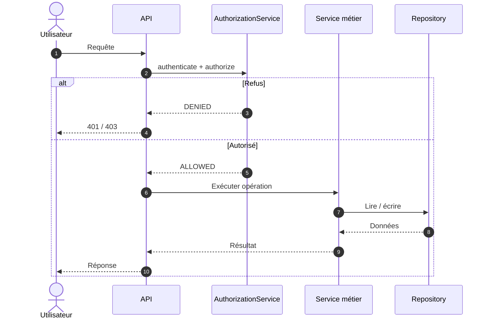

---

# 3. Cas d’utilisation 1 — Créer et publier une publication

## Objectif

Permettre à un responsable de département ou à un Admin de créer une publication et de la publier dans le respect du périmètre d’autorisation.

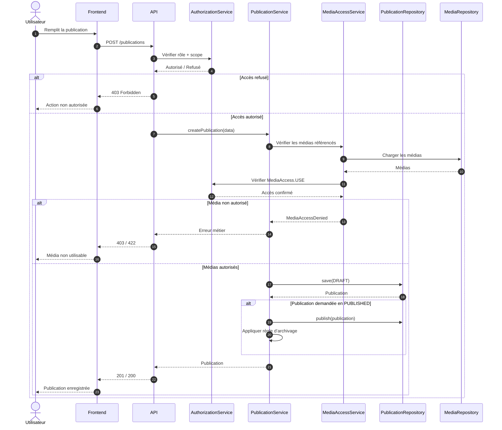

### Règle

Le frontend demande l’opération ; le backend décide si elle est autorisée.

---

# 4. Cas d’utilisation 2 — Publier une quatrième publication

## Objectif

Garantir qu’un département ne conserve que ses trois publications `PUBLISHED` les plus récentes.

Lorsqu’une quatrième publication est publiée, la plus ancienne des trois précédentes devient `ARCHIVED`.

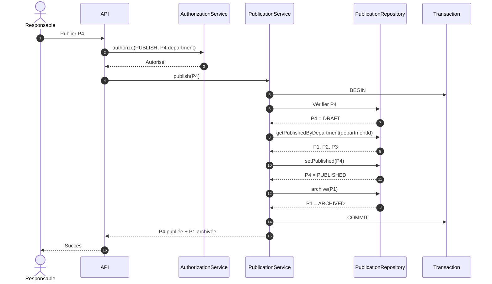

## Pourquoi une transaction ?

La publication et l’archivage constituent une seule opération métier.

L’état final ne doit jamais être incohérent.

La conception technique devra donc garantir l’atomicité et traiter les publications concurrentes.

---

# 5. Cas d’utilisation 3 — Utiliser un média avec contrôle d’accès

## Objectif

Démontrer que la bibliothèque média est globale, mais que l’utilisation d’un média dépend du département.

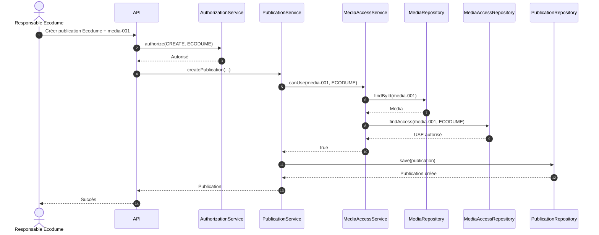

### Cas de refus

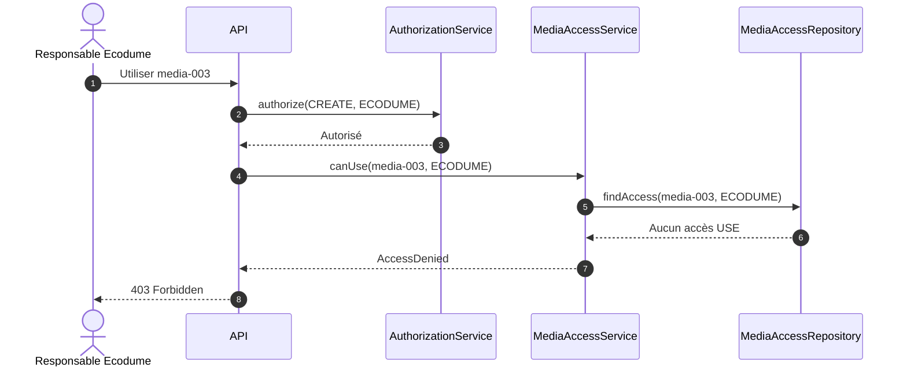

### Invariant

L’existence du média ne suffit pas :

```text
Media existe
+
Department autorisé
+
Permission USE
```

---

# 6. Cas d’utilisation 4 — Créer un compte Responsable de département

## Objectif

Permettre à l’Admin de créer un compte de responsable sans lui permettre de créer un Super Admin.

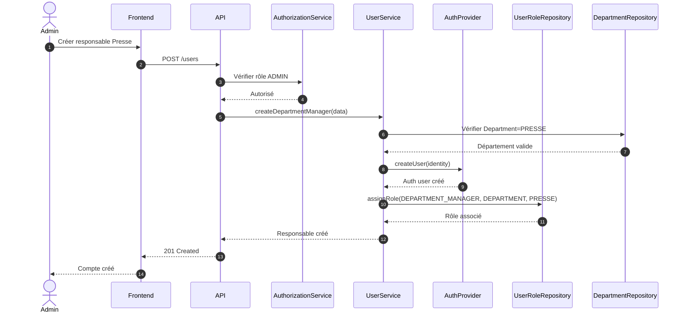

### Opération interdite

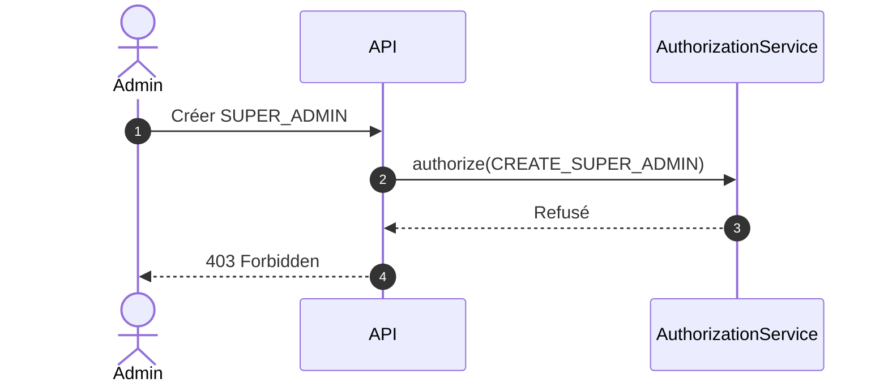

Règle :

```text
ADMIN
 ├── peut créer DEPARTMENT_MANAGER
 └── ne peut pas créer/modifier SUPER_ADMIN
```

---

# 7. Cas d’utilisation 5 — Soumettre une demande de prière

## Objectif

Permettre à un visiteur de transmettre une demande de prière avec ou sans nom.

La demande est protégée avant sa persistance selon le mécanisme cryptographique qui sera arrêté dans la conception technique.

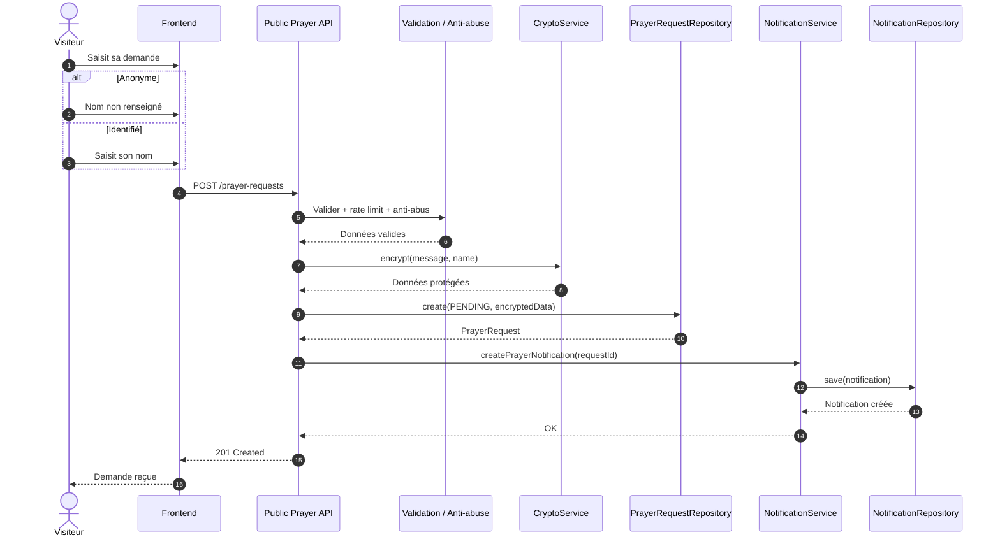

## Règles de confidentialité

Le contenu de la demande ne doit pas apparaître :

- dans les logs applicatifs ;
- dans les erreurs ;
- dans les notifications ;
- dans les réponses publiques ;
- dans une réponse destinée au Super Admin.

---

# 8. Cas d’utilisation 6 — Consulter et archiver une demande par un Admin

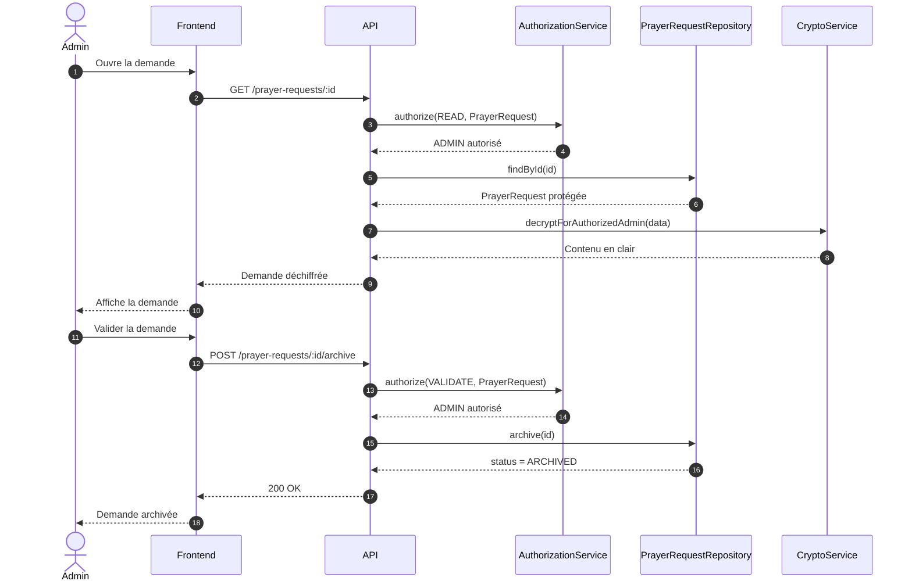

La donnée reste conservée :

```text
PENDING → ARCHIVED
```

---

# 9. Cas d’utilisation 7 — Tentative d’accès du Super Admin

## Objectif

Vérifier l’exception fondamentale :

> SUPER_ADMIN ne peut pas lire les demandes de prière.

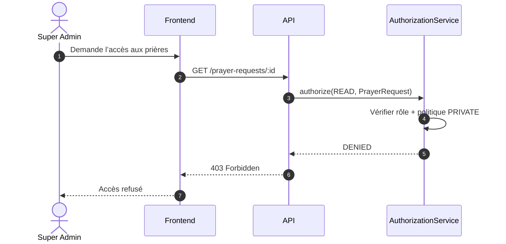

### Point de sécurité critique

Le refus doit intervenir **avant le déchiffrement**.

Le flux suivant est interdit :

```text
Super Admin
 ↓
API
 ↓
Repository
 ↓
CryptoService
 ↓
Texte en clair
 ↓
403
```

Le flux attendu est :

```text
Super Admin
 ↓
API
 ↓
AuthorizationService
 ↓
DENIED
```

---

# 10. Diagramme d’états — Publication

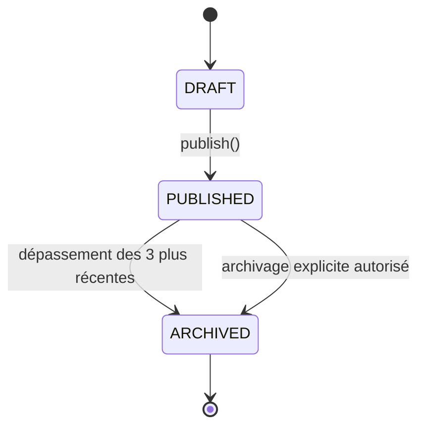

### Règle

Le passage automatique vers `ARCHIVED` est déclenché par la publication d’une nouvelle publication du même département.

Le nombre de publications `PUBLISHED` doit rester limité à trois par département.

---

# 11. Diagramme d’états — Demande de prière

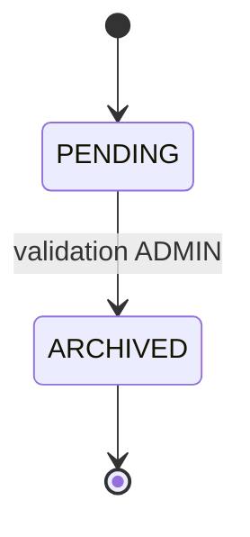

Il n’existe pas de suppression automatique lors de la validation.

---

# 12. Diagramme conceptuel — Accès à un média

L’accès au média n’est pas un état global du média.

Il dépend de la combinaison :

```text
Media
+
Department
+
Permission
```

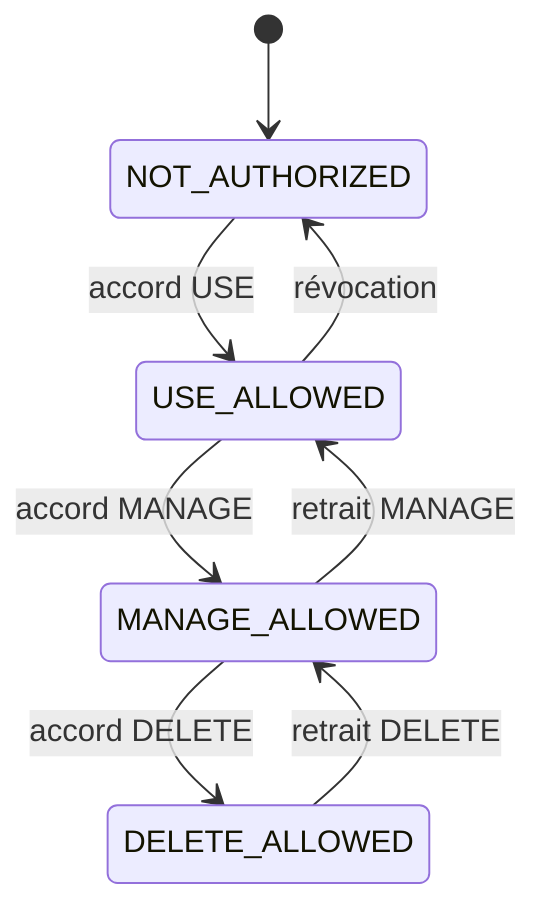

**Attention :** cette représentation est conceptuelle. La conception finale peut représenter `USE`, `MANAGE` et `DELETE` comme trois permissions indépendantes plutôt qu'une hiérarchie stricte.

---

# 13. Cas transversal — Responsable hors périmètre

Un responsable Presse ne doit pas pouvoir modifier une ressource Ecodume.

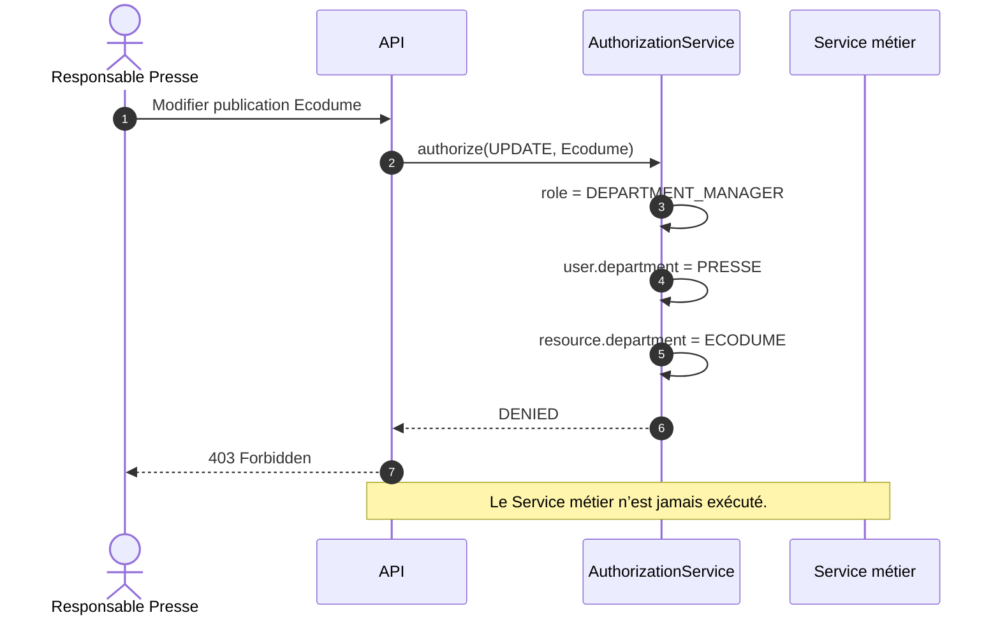

---

# 14. Cas transversal — Admin intervenant sur un contenu départemental

L’Admin dispose d’un périmètre global sur les contenus qu’il administre.

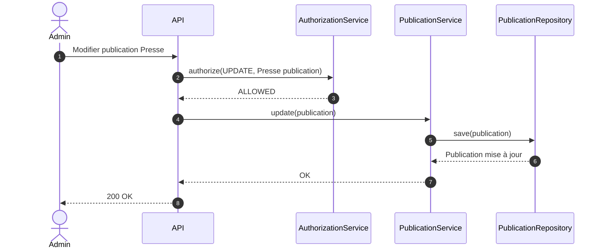

---

# 15. Concurrence sur l’archivage des publications

Le scénario de publication de la quatrième publication révèle une contrainte technique importante.

Deux publications peuvent être publiées presque simultanément :

```text
Requête A → P4
Requête B → P5
```

Sans protection transactionnelle ou concurrentielle, les deux opérations peuvent observer le même état :

```text
P1
P2
P3
```

et produire un état incohérent.

La conception technique devra donc prévoir une stratégie adaptée :

- transaction ;
- verrouillage approprié ;
- contrainte SQL ;
- ou mécanisme équivalent.

Le choix exact appartient à 3.3.

---

# 16. Flux métier complet d’une publication

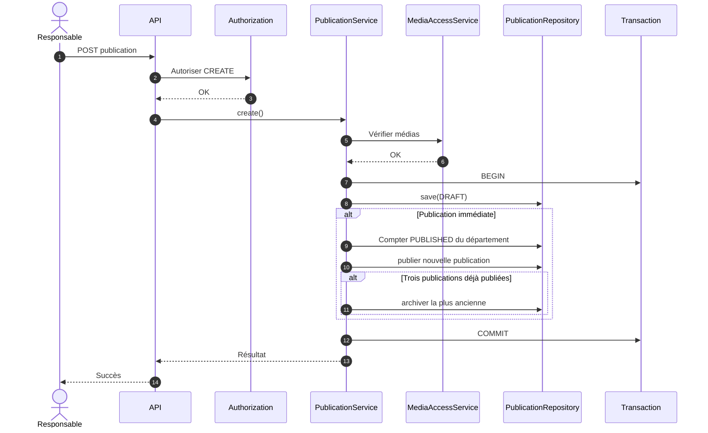

---

# 17. Validation du modèle métier par la dynamique

Les scénarios confirment les règles suivantes.

## RBAC

```text
Role + Scope + Department
```

déterminent l’autorisation.

## Autonomie départementale

Un responsable travaille sans validation préalable de l’Admin, mais uniquement dans son département.

## Administration globale

L’Admin peut intervenir sur les contenus départementaux.

## Bibliothèque média

Les médias sont centralisés et leur utilisation est gouvernée par `MediaAccess`.

## Publications

Le rattachement départemental permet d’appliquer la règle des trois publications indépendamment pour chaque département.

## Prières

Le workflow est :

```text
Public
  ↓
PENDING
  ↓
ADMIN
  ↓
ARCHIVED
```

## Confidentialité

L’autorisation est vérifiée avant toute opération de déchiffrement.

---

# 18. Points restant à fermer avant 3.3

La modélisation dynamique révèle quatre décisions à formaliser avant l’architecture.

## D1 — Événements globaux

Déterminer si :

```text
Event.department_id
```

est obligatoire ou nullable pour permettre des événements globaux.

## D2 — Permissions média

Déterminer si :

```text
USE < MANAGE < DELETE
```

est une hiérarchie stricte ou trois permissions indépendantes.

Le modèle métier favorise la seconde interprétation afin de préserver la distinction entre utilisation, modification et suppression.

## D3 — Cryptographie des prières

Formaliser :

- protocole ;
- génération des clés ;
- stockage ;
- déchiffrement ;
- gestion de plusieurs Admins ;
- rotation ;
- révocation ;
- récupération ;
- perte de clé.

Le point essentiel reste inchangé :

> le Super Admin ne doit pas pouvoir lire les demandes de prière en clair.

## D4 — Archivage concurrent

L'opération :

```text
nouvelle publication → PUBLISHED
+
ancienne plus récente parmi les trois → ARCHIVED
```

doit être atomique.

---

# 19. Conclusion

La dynamique du backend CCJV s’articule autour de quatre opérations transversales :

```text
1. AUTORISER
      ↓
2. EXÉCUTER LA RÈGLE MÉTIER
      ↓
3. PERSISTER DE FAÇON COHÉRENTE
      ↓
4. RETOURNER LE RÉSULTAT
```

Deux mécanismes métier sont particulièrement structurants :

### Publications

```text
3 PUBLISHED maximum par département
```

### Demandes de prière

```text
PRIVATE
+
ADMIN uniquement
+
protection cryptographique
+
Super Admin exclu
```

La modélisation dynamique fournit ainsi le pont entre le modèle métier et l’architecture logicielle.

La prochaine étape de la Phase 3 est **3.3 — Architecture logicielle** : couches, services, repositories, politiques d’autorisation, mécanisme cryptographique, contrats API et patterns.

Le code d’implémentation reste hors périmètre tant que les quatre sous-livrables de la Phase 3 ne sont pas finalisés.
