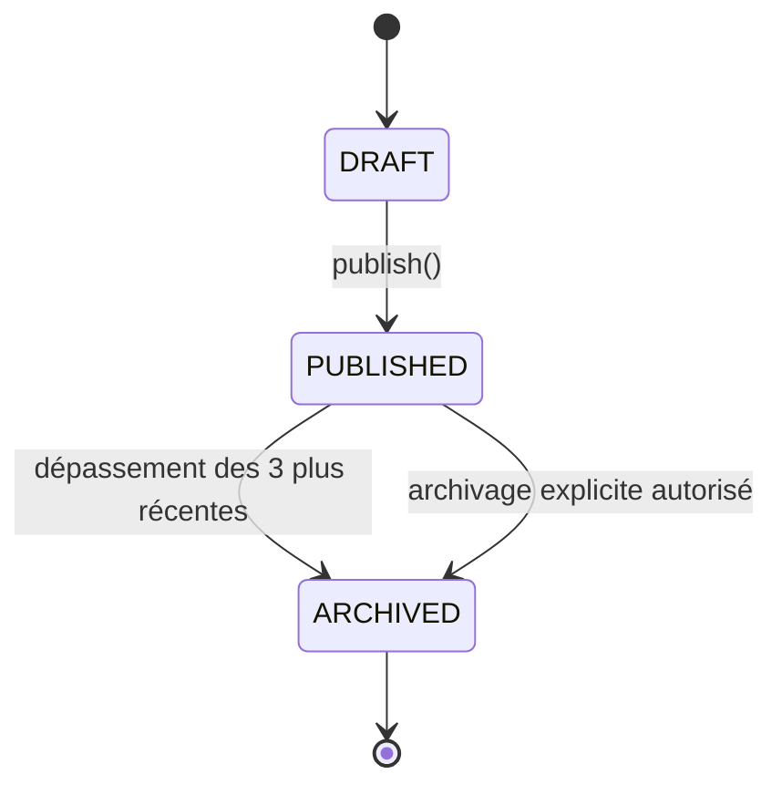
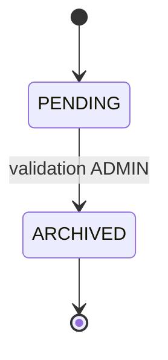
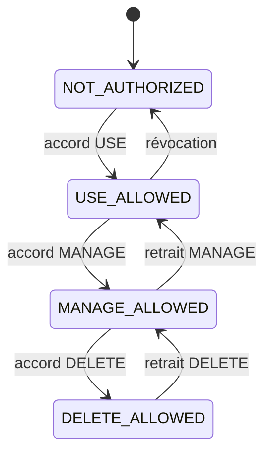

# Extrait structuré et citationnel — Documents 022, 023, 024

**Objet :** dépouillement intégral des trois documents de conception du backend CCJV, destiné à un architecte qui ne les a pas lus.
**Règle de citation :** toute affirmation est traçable (fichier + numéro de ligne + citation littérale). Aucune inférence, aucun comblement de vide : ce qui n'est pas écrit est déclaré **absent**.
**Date de lecture :** lecture intégrale, première à dernière ligne des trois fichiers.

## 0. Établissement des sources (vérification de périmètre)

| Réf. | Chemin réel dans le dépôt | Lignes | Taille | Statut déclaré par le document |
|---|---|---|---|---|
| 022 | `docs/022_modelisation_statique_UML.md` | 718 | ~14 Ko | L6 : « **Statut :** Modèle de conception — pré-GEL » |
| 023 | `docs/023_modelisation_dynamique_UML.md` | 861 | ~19 Ko | L6 : « **Statut :** Modèle de conception — pré-GEL » |
| 024 | `docs/024_architecture_logicielle_backend.md` | 1371 | ~28 Ko | L6 : « **Statut :** Conception — pré-GEL » |

**Écart de nommage à signaler :** la mission désigne le troisième document comme `docs/024-architecture_logicielle_backend.md` (trait d'union). Le fichier réel porte un **underscore** : `docs/024_architecture_logicielle_backend.md`. Vérifié par énumération du dossier `docs/` (le chemin avec trait d'union n'existe pas).

Document annexe consulté pour la section « Contradictions » uniquement : `docs/025-prompt_maitre_conception_roadmap_backend.md` (978 lignes). Les citations 025 sont explicitement étiquetées comme telles.

En-têtes des documents (pour situer la phase) :

- 022, L4 : « **Phase :** Phase 3 — COMMENT / 3.2 Modélisation dynamique & statique »
- 023, L4 : « **Phase :** Phase 3 — COMMENT / 3.2 Modélisation dynamique & statique »
- 024, L4-L5 : « **Phase :** Phase 3 — COMMENT » / « **Sous-phase :** 3.3 — Architecture logicielle »
- 024, L28 : « Le code d'implémentation n'est pas produit dans ce document. »

---

# Partie 1 — Modèle statique (022) : inventaire exhaustif

## 1.1. Objet du document (022 §1, L10-L19)

022 L12 : « Ce document transforme le modèle métier en une **modélisation statique UML**. »
022 L14 : « Le diagramme décrit les objets métier persistants ou structurants, leurs responsabilités et leurs relations. »
022 L16 : « Il ne constitue pas encore le schéma SQL définitif. »
022 L18 (verbatim complet) : « Les choix qui restent ouverts dans le modèle métier sont explicitement signalés, notamment la possibilité d'événements globaux et le mécanisme cryptographique des demandes de prière. »

## 1.2. Inventaire des classes, attributs et types (022 §2, diagramme L24-L188)

Le diagramme est unique (Mermaid `classDiagram`) et occupe 022 L24-L188. Il contient **17 boîtes** : **11 classes/entités** (dont 1 *value object*) et **6 énumérations**.

### 1.2.1. Classes / entités (11)

| # | Classe | Stéréotype | Lignes | Attributs (nom + type, tels qu'écrits) |
|---|---|---|---|---|
| 1 | `User` | — | L28-L33 | `+UUID id` (L29) ; `+string email` (L30) ; `+datetime createdAt` (L31) ; `+bool isActive` (L32) |
| 2 | `UserRole` | — | L49-L54 | `+UUID userId` (L50) ; `+Role role` (L51) ; `+Scope scope` (L52) ; `+UUID departmentId` (L53) |
| 3 | `Department` | — | L56-L63 | `+UUID id` (L57) ; `+string name` (L58) ; `+string code` (L59) ; `+string slug` (L60) ; `+string description` (L61) ; `+bool isActive` (L62) |
| 4 | `Publication` | — | L65-L76 | `+UUID id` (L66) ; `+UUID departmentId` (L67) ; `+string title` (L68) ; `+string slug` (L69) ; `+string excerpt` (L70) ; `+PublicationStatus status` (L71) ; `+datetime publishedAt` (L72) ; `+datetime archivedAt` (L73) ; `+datetime createdAt` (L74) ; `+datetime updatedAt` (L75) |
| 5 | `Event` | — | L85-L96 | `+UUID id` (L86) ; `+UUID departmentId` (L87) ; `+string title` (L88) ; `+string slug` (L89) ; `+string description` (L90) ; `+datetime startsAt` (L91) ; `+datetime endsAt` (L92) ; `+string location` (L93) ; `+datetime createdAt` (L94) ; `+datetime updatedAt` (L95) |
| 6 | `Media` | — | L98-L107 | `+UUID id` (L99) ; `+string storageKey` (L100) ; `+string filename` (L101) ; `+string mimeType` (L102) ; `+int size` (L103) ; `+string altText` (L104) ; `+datetime createdAt` (L105) ; `+datetime updatedAt` (L106) |
| 7 | `MediaAccess` | — | L109-L113 | `+UUID mediaId` (L110) ; `+UUID departmentId` (L111) ; `+MediaPermission permission` (L112) |
| 8 | `Page` | — | L122-L127 | `+string key` (L123) ; `+string template` (L124) ; `+JSON content` (L125) ; `+datetime updatedAt` (L126) |
| 9 | `Notification` | — | L129-L136 | `+UUID id` (L130) ; `+UUID recipientUserId` (L131) ; `+NotificationType type` (L132) ; `+string referenceId` (L133) ; `+bool isRead` (L134) ; `+datetime createdAt` (L135) |
| 10 | `PrayerRequest` | — | L143-L151 | `+UUID id` (L144) ; `+EncryptedData encryptedMessage` (L145) ; `+EncryptedData encryptedRequesterName` (L146) ; `+bool isAnonymous` (L147) ; `+PrayerRequestStatus status` (L148) ; `+datetime createdAt` (L149) ; `+datetime validatedAt` (L150) |
| 11 | `EncryptedData` | `<<value object>>` (L160) | L159-L164 | `+bytes ciphertext` (L161) ; `+bytes nonce` (L162) ; `+string keyReference` (L163) |

**Note factuelle sur l'optionalité :** le diagramme n'emploie que le préfixe de visibilité `+` ; **aucun marqueur d'optionalité par attribut** (`?`, `[0..1]`, `optional`) n'apparaît dans le diagramme (022 L24-L188). La **seule** obligation d'attribut énoncée dans tout 022 est celle de `Publication.department_id` (§14, L641 : « `Publication.department_id IS NOT NULL` »). Pour tous les autres attributs, l'optionalité **n'est pas déclarée dans 022**.

### 1.2.2. Énumérations et valeurs exactes (6)

| # | Énumération | Lignes | Valeurs exactes, dans l'ordre écrit |
|---|---|---|---|
| 1 | `Role` | L35-L40 | `SUPER_ADMIN` (L37) ; `ADMIN` (L38) ; `DEPARTMENT_MANAGER` (L39) |
| 2 | `Scope` | L42-L47 | `GLOBAL` (L44) ; `DEPARTMENT` (L45) ; `PRIVATE` (L46) |
| 3 | `PublicationStatus` | L78-L83 | `DRAFT` (L80) ; `PUBLISHED` (L81) ; `ARCHIVED` (L82) |
| 4 | `MediaPermission` | L115-L120 | `USE` (L117) ; `MANAGE` (L118) ; `DELETE` (L119) |
| 5 | `NotificationType` | L138-L141 | `PRAYER_REQUEST_RECEIVED` (L140) — **seule valeur** |
| 6 | `PrayerRequestStatus` | L153-L157 | `PENDING` (L155) ; `ARCHIVED` (L156) |

## 1.3. Diagramme reproduit en relations textuelles (022 §2, L166-L187)

Reprise **littérale** des lignes de relation du bloc Mermaid (aucune paraphrase) :

```text
L166 : User "1" --> "0..*" UserRole : possède
L167 : Role "1" --> "0..*" UserRole : définit
L168 : Scope "1" --> "0..*" UserRole : définit
L170 : Department "0..1" --> "0..*" UserRole : périmètre
L172 : Department "1" --> "0..*" Publication : possède
L173 : Department "1" --> "0..*" Event : organise
L175 : Publication "1" --> "0..*" Media : référence
L176 : Media "1" --> "0..*" MediaAccess : possède
L177 : Department "1" --> "0..*" MediaAccess : autorisation
L179 : User "1" --> "0..*" Notification : reçoit
L180 : Notification "0..*" --> "1" PrayerRequest : référence
L182 : Publication --> PublicationStatus : état
L183 : PrayerRequest --> PrayerRequestStatus : état
L184 : MediaAccess --> MediaPermission : droit
L185 : Notification --> NotificationType : type
L187 : PrayerRequest *-- EncryptedData : protège
```

Lisibilité « A — B » :

- `User 1 — 0..* UserRole` (possède)
- `Role 1 — 0..* UserRole` (définit)
- `Scope 1 — 0..* UserRole` (définit)
- `Department 0..1 — 0..* UserRole` (périmètre)
- `Department 1 — 0..* Publication` (possède)
- `Department 1 — 0..* Event` (organise)
- `Publication 1 — 0..* Media` (référence)
- `Media 1 — 0..* MediaAccess` (possède)
- `Department 1 — 0..* MediaAccess` (autorisation)
- `User 1 — 0..* Notification` (reçoit)
- `Notification 0..* — 1 PrayerRequest` (référence ; sens de lecture inverse des précédentes)
- `Publication — PublicationStatus` (état ; cardinalités non écrites)
- `PrayerRequest — PrayerRequestStatus` (état ; non écrites)
- `MediaAccess — MediaPermission` (droit ; non écrites)
- `Notification — NotificationType` (type ; non écrites)
- `PrayerRequest *-- EncryptedData` (protège — **composition**)

**Diagrammes/flux textuels reproduits, hors Mermaid :**

- 022 L254-L256 : « `Department 1 ─────── 0..* Publication` » avec L258 « Une publication appartient obligatoirement à un département. »
- 022 L262-L270 (cycle de la publication) :
```text
DRAFT
  │
  ▼
PUBLISHED
  │
  ▼
ARCHIVED
```
- 022 L286-L288 : « `Department 1 ─────── 0..* Event` »
- 022 L298-L300 : « `Department 0..1 ─────── 0..* Event` » (variante **conditionnelle**, voir §4.1)
- 022 L322-L333 (bibliothèque média) :
```text
                 ┌───────────────┐
                 │     Media     │
                 └───────┬───────┘
                         │
                  0..* MediaAccess
                         │
                         ▼
                 ┌───────────────┐
                 │  Department   │
                 └───────────────┘
```
- 022 L368-L370 : « `Publication 1 ─────── 0..* Media` »
- 022 L374-L380 (invariant) :
```text
Publication.department
        ↓
MediaAccess
        ↓
autorisation USE
```
- 022 L398-L403 :
```text
Page
 ├── key
 ├── template
 └── content JSON
```
- 022 L427-L430 : « `Scope = PRIVATE` » / « `Audience = ADMIN` »
- 022 L434-L440 (cycle prière) :
```text
PENDING
   │
   │ validation par ADMIN
   ▼
ARCHIVED
```
- 022 L482-L490 : `PrayerRequest → Notification → Admin User`
- 022 L496-L499 : « `type = PRAYER_REQUEST_RECEIVED` » / « `referenceId = <id de la demande>` »
- 022 L681-L704 (cinq noyaux métier, §16) :
```text
Administration
     │
     ├── Users / Roles / Scopes
     │
Organisation
     │
     └── Departments
            │
            ├── Publications
            └── Events

Médiathèque
     │
     └── Media ─── MediaAccess ─── Departments

Éditorial
     │
     └── Pages structurées

Confidentialité
     │
     └── PrayerRequest ─── Notifications
```

## 1.4. Clés primaires, clés étrangères et type d'identifiant — état exact

**Ce que 022 écrit :** tous les identifiants sont typés `UUID`.

Occurrences de `UUID` (022) : L29 (`User.id`), L50 (`UserRole.userId`), L53 (`UserRole.departmentId`), L57 (`Department.id`), L66 (`Publication.id`), L67 (`Publication.departmentId`), L86 (`Event.id`), L87 (`Event.departmentId`), L99 (`Media.id`), L110 (`MediaAccess.mediaId`), L111 (`MediaAccess.departmentId`), L130 (`Notification.id`), L131 (`Notification.recipientUserId`), L144 (`PrayerRequest.id`).

**Deux réserves formelles, toutes deux écrites dans le document (non inférées) :**

1. **Aucune clé primaire ni étrangère n'est déclarée comme telle.** Le diagramme n'emploie aucun stéréotype `<<PK>>`/`<<FK>>` ni aucune contrainte `{id}` (022 L24-L188).
2. 022 L666 (dans la liste §15 « Ce que ce diagramme ne fixe volontairement pas ») : « 3. les clés et index ; ».

Autrement dit : les attributs nommés `userId`, `departmentId`, `mediaId`, `recipientUserId`, `referenceId` existent **comme attributs** ; leur statut de clé étrangère **n'est pas déclaré dans 022**.

**Type d'identifiant :** 022 n'énonce nulle part la phrase « l'identifiant est un UUID ». Le seul élément de preuve est le type `UUID` porté par les 14 attributs listés ci-dessus. **Aucune occurrence** des termes `integer`, `bigint`, `serial`, `auto-increment`, `entier` comme type d'identifiant n'existe dans 022, 023 ou 024 (recherche effectuée sur `integer|bigint|serial|entier auto|int id|IDENTITY` dans les fichiers `02*.md` : seuls des résultats hors périmètre, dans `026` et `docs/audit/`).

Contribution de 024 §20 (L785-L790) au même point :
```text
Zod
→ departmentId est un UUID valide
```
024 L787 (verbatim) : « → departmentId est un UUID valide ».

Contribution de 023 : **aucun type d'identifiant n'est mentionné dans 023** (aucune occurrence de `UUID`).

> **Verdict sur le désaccord « UUID vs entier » :** dans 022/023/024, **un seul type est écrit : `UUID`** (022 pour tous les identifiants ; 024 L787 pour la validation `departmentId`). Aucun des trois documents ne mentionne d'identifiant entier, ni ne signale de désaccord sur ce point. Le désaccord avec des « documents antérieurs » **n'est pas traité dans 022/023/024** — ces trois fichiers ne le mentionnent pas.

## 1.5. Contraintes d'unicité et index

- Contraintes d'unicité **explicites** : **aucune**. Aucune occurrence de `unique`, `unicité`, `UNIQUE` dans 022 (recherche `unicit|unique` : seules les lignes L278 « uniquement » et L405 « uniquement », L652 « uniquement », sans rapport).
- Index : **explicitement non fixés** — 022 L664-L666 (voir ci-dessus) : « 3. les clés et index ; » figure dans la liste des points que « le diagramme ne tranche pas encore ».
- Seule règle proche de l'unicité, sur `Department` — 022 L246 (verbatim) : « Le code métier d'un département ne doit pas remplacer son identité persistée. » Cette phrase porte sur la primauté de l'identité persistée sur le `code`, **elle n'énonce pas de contrainte d'unicité** sur `code` ou `slug`.

## 1.6. Règles d'intégrité et contraintes métier (022 §14, L638-L656)

Reproduction **littérale** du bloc :

```text
Publication.department_id IS NOT NULL

DEPARTMENT_MANAGER.department_id
    = périmètre des ressources modifiables

Media n'appartient pas à un département

Publication → Media
    nécessite MediaAccess.USE

PrayerRequest
    → lecture ADMIN uniquement

SUPER_ADMIN
    → aucune lecture PrayerRequest
```

Cardinalités « à conserver » (022 §14, L621-L636), littéral :

```text
User 1 ───── 0..* UserRole

Department 1 ───── 0..* Publication

Department 1 ───── 0..* Event
                    [à confirmer]

Media 1 ───── 0..* MediaAccess

Department 1 ───── 0..* MediaAccess

Publication 1 ───── 0..* Media

User 1 ───── 0..* Notification
```

## 1.7. Règles énoncées par section de 022 (avec citations)

**§3.1 User / Role / Scope (L194-L222).** L196 : « Le modèle sépare volontairement : » ; L198-L201 : « **User** : identité/authentification ; **Role** : capacité métier générale ; **Scope** : périmètre d'action ; **Department** : périmètre organisationnel concret. » Structure L205-L211 :
```text
User
  └── UserRole
        ├── Role
        ├── Scope
        └── Department (si scope = DEPARTMENT)
```
Exemple L216-L219 : `Utilisateur : Jean` / `Role : DEPARTMENT_MANAGER` / `Scope : DEPARTMENT` / `Department : PRESSE`. L222 : « Jean peut donc exercer les capacités de responsable de département, mais uniquement sur Presse. »

**§4 Département (L226-L246).** L228 : « `Department` est une entité centrale du modèle. » ; L230-L236 : sert à « identifier une unité organisationnelle ; rattacher les publications ; rattacher les événements départementaux ; définir le périmètre des responsables ; contrôler les autorisations d'utilisation de certains médias. » Exemples de données L240-L244 :
```text
PRESSE
ECODUME
AFFAIRES-SOCIALES
```

**§5 Publication (L250-L279).** L258 : « Une publication appartient obligatoirement à un département. » L272 : « Le passage `PUBLISHED → ARCHIVED` est déclenché par la règle métier des trois dernières publications. » L274-L278 (encadré « Contrainte importante ») : « L'état `ARCHIVED` est persistant. » / « Il ne s'agit pas d'un statut calculé uniquement à partir de la date. »

**§6 Événement (L282-L305).** Voir §4.1 de cet extrait (point déterminant). L304 : « Le statut temporel d'un événement n'est pas assimilé au statut d'une publication. »

**§7 Média et MediaAccess (L308-L361).** L310 : « C'est un point central du modèle. » ; L312-L318 : « Il n'existe pas de relation : `Media → Department` au sens d'une appartenance exclusive. » ; L335 : « Un même média peut donc être utilisable par plusieurs départements. » Exemples L340-L350 :
```text
media-001
   ├── Presse
   └── Ecodume
```
```text
media-002
   └── Ecodume
```
L354-L358 :
```text
USE
MANAGE
DELETE
```
L360 : « Cette distinction devra être affinée dans le RBAC technique. »

**§8 Relation Publication / Media (L364-L387).** L384 (verbatim, citation en bloc) : « > Une publication ne peut référencer qu'un média utilisable par son département. » L386 : « Cette règle ne doit pas être déléguée au frontend. »

**§9 Page éditoriale (L390-L418).** L392 : « `Page` représente le conteneur éditorial structuré. » L394 : « Elle ne doit pas être interprétée comme un page builder. » L405 : « Le `content` contient uniquement les structures autorisées par le template. » L407-L415 : le code contrôle « le template ; les sections disponibles ; les variantes ; les champs attendus ; le rendu ; le responsive ; les contraintes visuelles. » L417 : « La donnée éditoriale fournit les valeurs. »

**§10 PrayerRequest (L421-L444).** L423 : « `PrayerRequest` est volontairement séparée du modèle de contenu classique. » L427-L430 :
```text
Scope = PRIVATE
Audience = ADMIN
```
L442 : « L'archivage conserve la donnée. »

**§11 Protection cryptographique (L446-L474).** Voir §4.3.

**§12 Notification (L476-L502).** L478 : « Une nouvelle demande de prière produit une notification destinée aux Admins. » L492 : « La notification référence la demande mais ne doit pas recopier son contenu sensible. » L501 : « L'interface Admin pourra ensuite demander l'accès à la demande selon la politique de confidentialité. »

**§13 Agrégats métier proposés (L505-L613).** Six agrégats, reproduits tels quels :

| Agrégat | Racine | Objets associés | Responsabilité (verbatim) |
|---|---|---|---|
| Administration (L509-L525) | `User` (L513) | UserRole, Role, Scope (L517-L519) | « identité ; rôle ; périmètre. » (L523-L525) |
| Département (L529-L545) | `Department` (L533) | « responsables ; publications ; événements selon les règles métier. » (L537-L539) | « organisation ; périmètre départemental. » (L543-L545) |
| Publication (L548-L563) | `Publication` (L552) | « références médias. » (L556) | « cycle éditorial ; rattachement départemental ; publication ; archivage. » (L560-L563) |
| Média (L567-L581) | `Media` (L571) | MediaAccess (L575) | « bibliothèque centrale ; droits d'utilisation. » (L579-L581) |
| Page éditoriale (L584-L594) | `Page` (L588) | — | « contenu éditorial structuré ; respect du template. » (L592-L594) |
| Prière (L597-L614) | `PrayerRequest` (L601) | « EncryptedData ; Notification comme conséquence métier. » (L605-L606) | « réception ; confidentialité ; validation ; archivage. » (L610-L613) |

**§15 Ce que ce diagramme ne fixe volontairement pas (L660-L673)** — liste **littérale** :
```text
1. si les événements peuvent être globaux ;
2. le schéma SQL exact ;
3. les clés et index ;
4. la stratégie précise de chiffrement des prières ;
5. le modèle exact de plusieurs comptes Admin ;
6. le détail des permissions USE / MANAGE / DELETE ;
7. les entités éditoriales complémentaires (`Leader`, `Testimony`, `CommunityFace`, `Verse`, `RhythmEntry`, `SocialLink`, `ScheduleEntry`, `SiteSettings`) ;
8. les règles de suppression et d'audit.
```
L673 : « Ces points appartiennent aux étapes suivantes de la conception. »

**§16 Conclusion (L677-L718).** L679 : « La modélisation statique fait apparaître cinq noyaux métier principaux ». Les 7 diagrammes de séquence recommandés (L708-L716), littéral :
```text
1. **Créer et publier une publication**
2. **Publier la quatrième publication et archiver automatiquement la plus ancienne**
3. **Créer une publication avec sélection de médias autorisés**
4. **Créer un compte Responsable de département**
5. **Soumettre une demande de prière**
6. **Consulter et archiver une demande de prière par un Admin**
7. **Refuser techniquement l'accès d'un Super Admin à une demande de prière**
```

---

# Partie 2 — Modèle dynamique (023) : inventaire exhaustif

## 2.1. Objet et liste des scénarios (023 §1, L10-L26)

L14 : « La présente modélisation dynamique décrit comment ces objets collaborent dans le temps pour réaliser les principaux cas d'utilisation du backend. »
Liste **littérale** des scénarios retenus (L18-L24) :
```text
1. création et publication d'une publication ;
2. archivage automatique lors de la publication d'une quatrième publication ;
3. utilisation d'un média avec contrôle d'accès ;
4. création d'un compte de responsable de département ;
5. soumission d'une demande de prière ;
6. consultation et archivage d'une demande de prière par un Admin ;
7. tentative d'accès d'un Super Admin à une demande de prière.
```
L26 (réserve importante sur le statut des composants) : « Les composants utilisés dans les diagrammes (`API`, `AuthorizationService`, `PublicationService`, etc.) sont conceptuels. Leur découpage exact sera arrêté dans 3.3 — Architecture logicielle. »

**Décompte des diagrammes :** 023 contient **13 diagrammes de séquence** (L53, L87, L153, L206, L245, L287, L324, L356, L410, L465, L592, L620, L677) et **3 diagrammes d'états** (L522, L544, L571).

## 2.2. Principe transversal d'autorisation (023 §2, L30-L76)

L32 : « Tous les cas d'utilisation protégés suivent le même principe : »
```text
Utilisateur
    ↓
Authentification
    ↓
Autorisation
    ↓
Règle métier
    ↓
Persistance
    ↓
Réponse
```
L48 (verbatim) : « Le frontend ne constitue jamais l'autorité de sécurité. »
L50 (verbatim) : « Masquer une action dans l'interface ne suffit pas : le backend doit toujours réévaluer le rôle, le scope et le périmètre de la ressource. »

Diagramme de séquence L53-L76 : acteurs/participants `Utilisateur`, `API`, `AuthorizationService`, `Service métier`, `Repository`. Séquence : `U->>API: Requête` ; `API->>AUTH: authenticate + authorize` ; `alt Refus` → `AUTH-->>API: DENIED` → `API-->>U: 401 / 403` ; `else Autorisé` → `ALLOWED` → `S->>R: Lire / écrire` → `Résultat` → `API-->>U: Réponse`.

## 2.3. Cas d'utilisation 1 — Créer et publier une publication (023 §3, L80-L141)

| Élément | Contenu |
|---|---|
| Objectif (L83) | « Permettre à un responsable de département ou à un Admin de créer une publication et de la publier dans le respect du périmètre d'autorisation. » |
| Acteur | `Utilisateur` (L90) ; `Frontend` (L91) |
| Déclencheur | L99 : `U->>F: Remplit la publication` ; L100 : `F->>API: POST /publications` |
| Participants | `API`, `AuthorizationService` (AUTH), `PublicationService` (PS), `MediaAccessService` (MAS), `PublicationRepository` (PR), `MediaRepository` (MR) — L92-L97 |
| Étapes (L102-L131) | 1) `API->>AUTH: Vérifier rôle + scope` ; 2) `AUTH-->>API: Autorisé / Refusé` ; 3) si autorisé : `API->>PS: createPublication(data)` ; 4) `PS->>MAS: Vérifier les médias référencés` ; 5) `MAS->>MR: Charger les médias` ; 6) `MAS->>AUTH: Vérifier MediaAccess.USE` ; 7) `MAS-->>AUTH` → `Accès confirmé` ; 8) `PS->>PR: save(DRAFT)` ; 9) si demandée en `PUBLISHED` : `PS->>PR: publish(publication)` puis `PS->>PS: Appliquer règle d'archivage` |
| Cas d'erreur | **Accès refusé** (L105-L107) : `API-->>F: 403 Forbidden` ; `F-->>U: Action non autorisée`. **Média non autorisé** (L117-L121) : `MAS-->>PS: MediaAccessDenied` ; `PS-->>API: Erreur métier` ; `API-->>F: 403 / 422` ; `F-->>U: Média non utilisable` |
| Résultat | L132 : `API-->>F: 201 / 200` ; L133 : `F-->>U: Publication enregistrée` |
| Règle (L140) | « Le frontend demande l'opération ; le backend décide si elle est autorisée. » |

## 2.4. Cas d'utilisation 2 — Publier une quatrième publication (023 §4, L144-L195)

| Élément | Contenu |
|---|---|
| Objectif (L148) | « Garantir qu'un département ne conserve que ses trois publications `PUBLISHED` les plus récentes. » |
| Règle métier (L150) | « Lorsqu'une quatrième publication est publiée, la plus ancienne des trois précédentes devient `ARCHIVED`. » |
| Acteur | `Responsable` (L156) |
| Déclencheur | L163 : `U->>API: Publier P4` |
| Participants | `API`, `AuthorizationService`, `PublicationService`, `PublicationRepository`, `Transaction` (L157-L161) |
| Étapes (L164-L186) | 1) `API->>AUTH: authorize(PUBLISH, P4.department)` → `Autorisé` ; 2) `API->>PS: publish(P4)` ; 3) `PS->>TX: BEGIN` ; 4) `PS->>PR: Vérifier P4` → `P4 = DRAFT` ; 5) `PS->>PR: getPublishedByDepartment(departmentId)` → `P1, P2, P3` ; 6) `PS->>PR: setPublished(P4)` → `P4 = PUBLISHED` ; 7) `PS->>PR: archive(P1)` → `P1 = ARCHIVED` ; 8) `PS->>TX: COMMIT` |
| Cas d'erreur | **Aucun cas d'erreur explicite** dans ce diagramme. La section « Pourquoi une transaction ? » (L189-L195) pose : L191 « La publication et l'archivage constituent une seule opération métier. » ; L193 « L'état final ne doit jamais être incohérent. » ; L195 « La conception technique devra donc garantir l'atomicité et traiter les publications concurrentes. » |
| Résultat | L185 : `PS-->>API: P4 publiée + P1 archivée` ; L186 : `API-->>U: Succès` |

## 2.5. Cas d'utilisation 3 — Utiliser un média avec contrôle d'accès (023 §5, L199-L278)

| Élément | Contenu |
|---|---|
| Objectif (L203) | « Démontrer que la bibliothèque média est globale, mais que l'utilisation d'un média dépend du département. » |
| Acteur | `Responsable Ecodume` (L209) |
| Déclencheur | L218 : `U->>API: Créer publication Ecodume + media-001` |
| Participants | `API`, `AuthorizationService`, `PublicationService`, `MediaAccessService`, `MediaRepository`, `MediaAccessRepository`, `PublicationRepository` (L210-L216) |
| Étapes (L220-L239) | `API->>AUTH: authorize(CREATE, ECODUME)` → `Autorisé` ; `API->>PS: createPublication(...)` ; `PS->>MAS: canUse(media-001, ECODUME)` ; `MAS->>MR: findById(media-001)` → `Media` ; `MAS->>MAR: findAccess(media-001, ECODUME)` → `USE autorisé` ; `MAS-->>PS: true` ; `PS->>PR: save(publication)` → `Publication créée` |
| Cas d'erreur | **Cas de refus** (diagramme séparé L245-L264) : `U->>API: Utiliser media-003` ; `API->>AUTH: authorize(CREATE, ECODUME)` → `Autorisé` ; `API->>MAS: canUse(media-003, ECODUME)` ; `MAS->>MAR: findAccess(media-003, ECODUME)` → `Aucun accès USE` ; `MAS-->>API: AccessDenied` ; `API-->>U: 403 Forbidden` |
| Résultat | L239 : `API-->>U: Succès` |
| Invariant (L266-L276) | L268 : « L'existence du média ne suffit pas : » puis `Media existe` + `Department autorisé` + `Permission USE` |

## 2.6. Cas d'utilisation 4 — Créer un compte Responsable de département (023 §6, L280-L343)

| Élément | Contenu |
|---|---|
| Objectif (L284) | « Permettre à l'Admin de créer un compte de responsable sans lui permettre de créer un Super Admin. » |
| Acteur | `Admin` (L289) |
| Déclencheur | L299 : `A->>F: Créer responsable Presse` ; L300 : `F->>API: POST /users` |
| Participants | `Frontend`, `API`, `AuthorizationService`, `UserService`, `AuthProvider`, `UserRoleRepository`, `DepartmentRepository` (L290-L296) |
| Étapes (L302-L318) | `API->>AUTH: Vérifier rôle ADMIN` → `Autorisé` ; `API->>US: createDepartmentManager(data)` ; `US->>DR: Vérifier Department=PRESSE` → `Département valide` ; `US->>AS: createUser(identity)` → `Auth user créé` ; `US->>UR: assignRole(DEPARTMENT_MANAGER, DEPARTMENT, PRESSE)` → `Rôle associé` ; `US-->>API: Responsable créé` |
| Cas d'erreur | **Opération interdite** (diagramme L324-L335) : `A->>API: Créer SUPER_ADMIN` ; `API->>AUTH: authorize(CREATE_SUPER_ADMIN)` ; `AUTH-->>API: Refusé` ; `API-->>A: 403 Forbidden` |
| Résultat | L317 : `API-->>F: 201 Created` ; L318 : `F-->>A: Compte créé` |
| Règle (L339-L343) | `ADMIN` / `├── peut créer DEPARTMENT_MANAGER` / `└── ne peut pas créer/modifier SUPER_ADMIN` |

## 2.7. Cas d'utilisation 5 — Soumettre une demande de prière (023 §7, L347-L404)

| Élément | Contenu |
|---|---|
| Objectif (L351) | « Permettre à un visiteur de transmettre une demande de prière avec ou sans nom. » |
| Réserve (L353) | « La demande est protégée avant sa persistance selon le mécanisme cryptographique qui sera arrêté dans la conception technique. » |
| Acteur | `Visiteur` (L359) |
| Déclencheur | L376 : `F->>API: POST /prayer-requests` |
| Participants | `Frontend`, `Public Prayer API`, `Validation / Anti-abuse`, `CryptoService`, `PrayerRequestRepository`, `NotificationService`, `NotificationRepository` (L360-L366) |
| Étapes (L368-L392) | `alt Anonyme` → L371 `V->>F: Nom non renseigné` ; `else Identifié` → L373 `V->>F: Saisit son nom` ; puis `API->>VAL: Valider + rate limit + anti-abus` → `Données valides` ; `API->>CS: encrypt(message, name)` → `Données protégées` ; `API->>PR: create(PENDING, encryptedData)` → `PrayerRequest` ; `API->>NS: createPrayerNotification(requestId)` ; `NS->>NR: save(notification)` → `Notification créée` ; `NS-->>API: OK` |
| Cas d'erreur | **Aucun cas d'erreur explicite** (le refus de validation ou de rate limit n'est pas détaillé ; les mécanismes sont seulement nommés à L377) |
| Résultat | L391 : `API-->>F: 201 Created` ; L392 : `F-->>V: Demande reçue` |
| Règles de confidentialité (L395-L403) | « Le contenu de la demande ne doit pas apparaître : » — « dans les logs applicatifs ; dans les erreurs ; dans les notifications ; dans les réponses publiques ; dans une réponse destinée au Super Admin. » |

## 2.8. Cas d'utilisation 6 — Consulter et archiver une demande par un Admin (023 §8, L407-L452)

| Élément | Contenu |
|---|---|
| Objectif (titre) | L407 : « Consulter et archiver une demande par un Admin » — **pas de bloc « Objectif »** dans cette section |
| Acteur | `Admin` (L413) |
| Déclencheur | L420 : `A->>F: Ouvre la demande` ; L421 : `F->>API: GET /prayer-requests/:id` |
| Participants | `Frontend`, `API`, `AuthorizationService`, `PrayerRequestRepository`, `CryptoService` (L414-L418) |
| Étapes (L423-L445) | Lecture : `API->>AUTH: authorize(READ, PrayerRequest)` → `ADMIN autorisé` ; `API->>PR: findById(id)` → `PrayerRequest protégée` ; `API->>CS: decryptForAuthorizedAdmin(data)` → `Contenu en clair` ; `API-->>F: Demande déchiffrée` ; `F-->>A: Affiche la demande`. Archivage : `A->>F: Valider la demande` ; `F->>API: POST /prayer-requests/:id/archive` ; `API->>AUTH: authorize(VALIDATE, PrayerRequest)` → `ADMIN autorisé` ; `API->>PR: archive(id)` → `status = ARCHIVED` |
| Cas d'erreur | **Aucun cas d'erreur explicite** dans ce diagramme |
| Résultat | L444 : `API-->>F: 200 OK` ; L445 : `F-->>A: Demande archivée` |
| Conservations (L448-L452) | « La donnée reste conservée : » `PENDING → ARCHIVED` |

## 2.9. Cas d'utilisation 7 — Tentative d'accès du Super Admin (023 §9, L456-L515)

| Élément | Contenu |
|---|---|
| Objectif (L460) | « Vérifier l'exception fondamentale : » ; L462 (citation en bloc) : « > SUPER_ADMIN ne peut pas lire les demandes de prière. » |
| Acteur | `Super Admin` (L468) |
| Déclencheur | L473 : `SA->>F: Demande l'accès aux prières` ; L474 : `F->>API: GET /prayer-requests/:id` |
| Participants | `Frontend`, `API`, `AuthorizationService` (L469-L471) — **ni Repository ni CryptoService** |
| Étapes (L476-L482) | `API->>AUTH: authorize(READ, PrayerRequest)` ; `AUTH->>AUTH: Vérifier rôle + politique PRIVATE` ; `AUTH-->>API: DENIED` ; `API-->>F: 403 Forbidden` ; `F-->>SA: Accès refusé` |
| Cas d'erreur | C'est le scénario entier : refus par `403 Forbidden` |
| Résultat | Refus |
| Point de sécurité critique (L485-L515) | L487 : « Le refus doit intervenir **avant le déchiffrement**. » L489 : « Le flux suivant est interdit : » — `Super Admin ↓ API ↓ Repository ↓ CryptoService ↓ Texte en clair ↓ 403`. L505 : « Le flux attendu est : » — `Super Admin ↓ API ↓ AuthorizationService ↓ DENIED` |

## 2.10. Diagramme d'états — Publication (023 §10, L519-L538)


Transitions et déclencheurs (littéraux) :

| De | Vers | Déclencheur |
|---|---|---|
| `[*]` | `DRAFT` | création (étiquette absente) |
| `DRAFT` | `PUBLISHED` | `publish()` |
| `PUBLISHED` | `ARCHIVED` | « dépassement des 3 plus récentes » |
| `PUBLISHED` | `ARCHIVED` | « archivage explicite autorisé » |
| `ARCHIVED` | `[*]` | — (étiquette absente) |

Règles (L533-L538) : L535 « Le passage automatique vers `ARCHIVED` est déclenché par la publication d'une nouvelle publication du même département. » ; L537 « Le nombre de publications `PUBLISHED` doit rester limité à trois par département. »

## 2.11. Diagramme d'états — Demande de prière (023 §11, L541-L554)


| De | Vers | Déclencheur |
|---|---|---|
| `[*]` | `PENDING` | réception (étiquette absente) |
| `PENDING` | `ARCHIVED` | « validation ADMIN » |
| `ARCHIVED` | `[*]` | — |

L552 (verbatim) : « Il n'existe pas de suppression automatique lors de la validation. »

## 2.12. Diagramme conceptuel — Accès à un média (023 §12, L556-L583)

L558 : « L'accès au média n'est pas un état global du média. » L560 : « Il dépend de la combinaison : » `Media` + `Department` + `Permission`.


| De | Vers | Déclencheur |
|---|---|---|
| `[*]` | `NOT_AUTHORIZED` | — |
| `NOT_AUTHORIZED` | `USE_ALLOWED` | « accord USE » |
| `USE_ALLOWED` | `MANAGE_ALLOWED` | « accord MANAGE » |
| `MANAGE_ALLOWED` | `DELETE_ALLOWED` | « accord DELETE » |
| `USE_ALLOWED` | `NOT_AUTHORIZED` | « révocation » |
| `MANAGE_ALLOWED` | `USE_ALLOWED` | « retrait MANAGE » |
| `DELETE_ALLOWED` | `MANAGE_ALLOWED` | « retrait DELETE » |

L583 (verbatim) : « **Attention :** cette représentation est conceptuelle. La conception finale peut représenter `USE`, `MANAGE` et `DELETE` comme trois permissions indépendantes plutôt qu'une hiérarchie stricte. »

## 2.13. Cas transversaux (023 §13 et §14)

**§13 — Responsable hors périmètre (L587-L611).** L589 : « Un responsable Presse ne doit pas pouvoir modifier une ressource Ecodume. » Acteur `Responsable Presse` (L595). Séquence : `P->>API: Modifier publication Ecodume` ; `API->>AUTH: authorize(UPDATE, Ecodume)` ; puis vérifications internes L603-L605 : `role = DEPARTMENT_MANAGER` ; `user.department = PRESSE` ; `resource.department = ECODUME` ; `AUTH-->>API: DENIED` ; `API-->>P: 403 Forbidden` ; L610 (note du diagramme) : « Le Service métier n'est jamais exécuté. »

**§14 — Admin intervenant sur un contenu départemental (L615-L638).** L617 : « L'Admin dispose d'un périmètre global sur les contenus qu'il administre. » Acteur `Admin`. `A->>API: Modifier publication Presse` ; `API->>AUTH: authorize(UPDATE, Presse publication)` → `ALLOWED` ; `API->>S: update(publication)` ; `S->>R: save(publication)` → `Publication mise à jour` ; `API-->>A: 200 OK`. Aucun cas d'erreur.

## 2.14. Concurrence, transactions, atomicité, idempotence (023 §4, §15, §16, §18-D4)

- **§4 L189-L195** : transaction obligatoire (voir 2.4).
- **§15 — Concurrence sur l'archivage des publications (L642-L670).** L644 : « Le scénario de publication de la quatrième publication révèle une contrainte technique importante. » L646 : « Deux publications peuvent être publiées presque simultanément : » `Requête A → P4` / `Requête B → P5` (L649-L650). L653 : « Sans protection transactionnelle ou concurrentielle, les deux opérations peuvent observer le même état : » `P1 P2 P3` (L656-L658). L661 : « et produire un état incohérent. » L663-L670 (littéral) :
```text
La conception technique devra donc prévoir une stratégie adaptée :

- transaction ;
- verrouillage approprié ;
- contrainte SQL ;
- ou mécanisme équivalent.
```
L670 : « Le choix exact appartient à 3.3. »
- **§16 — Flux métier complet d'une publication (L674-L713)** : `U->>API: POST publication` ; `API->>AUTH: Autoriser CREATE` → `OK` ; `API->>PS: create()` ; `PS->>MAS: Vérifier médias` → `OK` ; `PS->>TX: BEGIN` ; `PS->>PR: save(DRAFT)` ; `alt Publication immédiate` → `PS->>PR: Compter PUBLISHED du département` ; `PS->>PR: publier nouvelle publication` ; `alt Trois publications déjà publiées` → `PS->>PR: archiver la plus ancienne` ; puis `PS->>TX: COMMIT` ; `PS-->>API: Résultat` ; `API-->>U: Succès`.
- **§18 D4 — Archivage concurrent (L809-L819)**, verbatim : « L'opération : » `nouvelle publication → PUBLISHED` `+` `ancienne plus récente parmi les trois → ARCHIVED` « doit être atomique. » (L819 : « doit être atomique. »)
- **Idempotence :** le mot et le concept **n'apparaissent nulle part dans 023** (recherche `idempot` : 0 occurrence dans 023, 022 et 024).

## 2.15. Règles de sécurité décrites dans les scénarios (023)

| Règle | Section / ligne | Citation littérale |
|---|---|---|
| Le frontend n'est jamais l'autorité | §2 L48 | « Le frontend ne constitue jamais l'autorité de sécurité. » |
| Réévaluation systématique rôle/scope/périmètre | §2 L50 | « Masquer une action dans l'interface ne suffit pas : le backend doit toujours réévaluer le rôle, le scope et le périmètre de la ressource. » |
| Autorisation avant règle métier | §2 L37-L44 | Chaîne « Authentification ↓ Autorisation ↓ Règle métier ↓ Persistance ↓ Réponse » |
| Média : existence ≠ droit | §5 L266-L276 | « L'existence du média ne suffit pas : » |
| ADMIN ne peut pas créer/modifier SUPER_ADMIN | §6 L339-L343 | « ADMIN / ├── peut créer DEPARTMENT_MANAGER / └── ne peut pas créer/modifier SUPER_ADMIN » |
| Contenu de prière hors logs/erreurs/notifications/réponses | §7 L395-L403 | « Le contenu de la demande ne doit pas apparaître : dans les logs applicatifs ; dans les erreurs ; dans les notifications ; dans les réponses publiques ; dans une réponse destinée au Super Admin. » |
| SUPER_ADMIN ne lit pas les prières | §9 L462 | « > SUPER_ADMIN ne peut pas lire les demandes de prière. » |
| Refus **avant** déchiffrement | §9 L487 | « Le refus doit intervenir **avant le déchiffrement**. » |
| Interdiction du flux « déchiffrer puis refuser » | §9 L489-L503 | « Le flux suivant est interdit : Super Admin ↓ API ↓ Repository ↓ CryptoService ↓ Texte en clair ↓ 403 » |
| Périmètre départemental strict | §13 L589, L610 | « Un responsable Presse ne doit pas pouvoir modifier une ressource Ecodume. » / « Le Service métier n'est jamais exécuté. » |
| Confidentialité : authz avant déchiffrement | §17 L759-L761 | « L'autorisation est vérifiée avant toute opération de déchiffrement. » |

## 2.16. Validation du modèle métier par la dynamique (023 §17, L717-L763)

L720 : « Les scénarios confirment les règles suivantes. »

- **RBAC** (L721-L727) : « `Role + Scope + Department` » / L727 « déterminent l'autorisation. »
- **Autonomie départementale** (L729-L731) : L731 « Un responsable travaille sans validation préalable de l'Admin, mais uniquement dans son département. »
- **Administration globale** (L733-L735) : L735 « L'Admin peut intervenir sur les contenus départementaux. »
- **Bibliothèque média** (L737-L739) : L739 « Les médias sont centralisés et leur utilisation est gouvernée par `MediaAccess`. »
- **Publications** (L741-L743) : L743 « Le rattachement départemental permet d'appliquer la règle des trois publications indépendamment pour chaque département. »
- **Prières** (L745-L757) : workflow `Public ↓ PENDING ↓ ADMIN ↓ ARCHIVED`.
- **Confidentialité** (L759-L761) : voir tableau ci-dessus.

## 2.17. Points restant à fermer avant 3.3 (023 §18, L765-L819)

L767 : « La modélisation dynamique révèle quatre décisions à formaliser avant l'architecture. »

- **D1 — Événements globaux (L769-L777)** : « Déterminer si : » `Event.department_id` « est obligatoire ou nullable pour permettre des événements globaux. »
- **D2 — Permissions média (L779-L789)** : « Déterminer si : » `USE < MANAGE < DELETE` « est une hiérarchie stricte ou trois permissions indépendantes. » L789 : « Le modèle métier favorise la seconde interprétation afin de préserver la distinction entre utilisation, modification et suppression. »
- **D3 — Cryptographie des prières (L791-L807)** : « Formaliser : » — « protocole ; génération des clés ; stockage ; déchiffrement ; gestion de plusieurs Admins ; rotation ; révocation ; récupération ; perte de clé. » L805 : « Le point essentiel reste inchangé : » L807 : « > le Super Admin ne doit pas pouvoir lire les demandes de prière en clair. »
- **D4 — Archivage concurrent (L809-L819)** : voir 2.14.

## 2.18. Conclusion (023 §19, L823-L861)

L825 : « La dynamique du backend CCJV s'articule autour de quatre opérations transversales : »
```text
1. AUTORISER
      ↓
2. EXÉCUTER LA RÈGLE MÉTIER
      ↓
3. PERSISTER DE FAÇON COHÉRENTE
      ↓
4. RETOURNER LE RÉSULTAT
```
L839-L843 : « Publications » → « 3 PUBLISHED maximum par département ». L845-L855 : « Demandes de prière » → « PRIVATE + ADMIN uniquement + protection cryptographique + Super Admin exclu ». L859 : « La prochaine étape de la Phase 3 est **3.3 — Architecture logicielle** : couches, services, repositories, politiques d'autorisation, mécanisme cryptographique, contrats API et patterns. » L861 : « Le code d'implémentation reste hors périmètre tant que les quatre sous-livrables de la Phase 3 ne sont pas finalisés. »

---

# Partie 3 — Architecture logicielle (024) : inventaire exhaustif

## 3.1. Architecture cible et rôle exact de chaque couche (024 §2 L32-L68 ; §31 L1078-L1121 ; §34 L1195-L1221)

**§2 — schéma cible (L36-L63)** : `CLIENTS / FRONTENDS` (« Site public + Back-office », L38-L39) → `HTTPS / REST` (L41) → `API / PRESENTATION` (« Controllers • Routes • DTO • Validation • HTTP Errors », L44-L45) → `APPLICATION / MÉTIER` (« Use Cases • Services • Policies • Transactions », L49-L50) → branche double vers `DOMAIN` (« Entités • Value Objects / Règles métier • Ports », L55-L57) et `INFRASTRUCTURE` (« PostgreSQL • Storage / Supabase Auth • Crypto », L55-L57) → `PostgreSQL / Storage` (L62).

L67 (principe, citation en bloc) : « > **La logique métier ne dépend pas de l'interface HTTP ni directement des fournisseurs d'infrastructure.** »

**§31 — architecture logique complète (L1080-L1121)** : `Next.js Public` → `Next.js Backoffice` → `HTTPS` → `Express API /api/v1` → `Presentation / HTTP (Routes / Controllers / Zod)` → `Application (Use Cases / Services / Policy)` → `Domain (Entities / Rules / Interfaces)` → `Infrastructure (Drizzle / Supabase / Storage / Auth / Crypto / Logging)` → `PostgreSQL` et `Supabase Storage / Auth`.

**§34 — contrat de dépendance (L1195-L1221)**, littéral :
```text
Presentation
    ↓
Application
    ↓
Domain

Infrastructure
    ↓
implémente les interfaces nécessaires
```
L1211-L1219 : « Le domaine ne dépend pas : » `Express`, `Drizzle`, `Supabase`, `Next.js`, `Railway`. L1221 : « L'infrastructure, elle, peut dépendre de ces technologies. »

**Rôle de chaque couche — ce que 024 écrit explicitement :**

| Couche | Contenu assigné (verbatim) | Sources |
|---|---|---|
| Présentation / API | « Controllers • Routes • DTO • Validation • HTTP Errors » ; « Routes / Controllers / Zod » | §2 L45 ; §31 L1098 |
| Application / Métier | « Use Cases • Services • Policies • Transactions » ; « Use Cases / Services / Policy » | §2 L50 ; §31 L1103 |
| Domain | « Entités • Value Objects / Règles métier • Ports » ; « Entities / Rules / Interfaces » | §2 L56-L57 ; §31 L1108 |
| Infrastructure | « PostgreSQL • Storage / Supabase Auth • Crypto » ; « Drizzle / Supabase / Storage / Auth / Crypto / Logging » | §2 L56-L57 ; §31 L1113-L1114 |
| Clients | « Site public + Back-office » | §2 L38-L39 |

**§4 — Principes architecturaux (L95-L169).**

- **4.1 Backend comme autorité (L97-L111)** : L99 « Le backend est la source d'autorité pour : » — « authentification ; autorisation ; règles métier ; validation ; états ; relations ; transitions ; accès aux médias ; confidentialité. » L111 : « Le frontend ne doit jamais être considéré comme une frontière de sécurité. »
- **4.2 API-first (L115-L125)** : L117 « Le backend expose une API REST versionnée : » `/api/v1` ; L123 « Le contrat est documenté avec OpenAPI. » ; L125 « Le site public et le back-office consomment cette API. »
- **4.3 Pas d'accès direct frontend → base (L129-L147)** : L131 « Le frontend ne communique pas directement avec PostgreSQL. » Flux L135-L145 : `Frontend ↓ API ↓ Application / Domain ↓ Repository ↓ PostgreSQL`. L147 : « Le frontend ne reçoit jamais les credentials privilégiés de la base ou de Supabase. »
- **4.4 Pas de logique métier dans les controllers (L151-L169)** : L153-L159 le controller « reçoit une requête ; récupère l'identité ; valide les données d'entrée ; appelle un use case ; transforme le résultat en réponse HTTP. » L161-L166 il « ne décide pas : qui peut modifier une publication ; quelle publication archiver ; si un média est utilisable ; si une prière peut être déchiffrée. » L168 : « Ces règles appartiennent aux couches métier/politiques. »

## 3.2. Stack technique (024 §3, L73-L91) — littéral

```text
| Langage | TypeScript |
| Runtime | Node.js |
| Framework HTTP | Express |
| Base de données | PostgreSQL |
| ORM / accès DB | Drizzle ORM |
| Authentification | Supabase Auth |
| Stockage fichiers | Supabase Storage |
| Validation | Zod |
| API | REST /api/v1 |
| Documentation API | OpenAPI / Swagger |
| Hébergement backend | Railway |
| Frontend public | Next.js / Vercel |
| DNS | Namecheap |
```
L91 (verbatim) : « Le choix est cohérent avec le socle déjà retenu pour le projet : TypeScript/Express côté backend, PostgreSQL/Supabase pour les données et Supabase Auth/Storage pour les services associés. »

## 3.3. Arborescence de modules/paquets proposée, telle qu'écrite (024 §5, L174-L230)

**Structure cible (L176-L206)**, littéral :
```text
src/
├── app/
│   ├── routes/
│   ├── middleware/
│   ├── errors/
│   └── http/
│
├── modules/
│   ├── auth/
│   ├── users/
│   ├── departments/
│   ├── publications/
│   ├── events/
│   ├── media/
│   ├── pages/
│   ├── prayers/
│   ├── notifications/
│   └── settings/
│
├── shared/
│   ├── authorization/
│   ├── validation/
│   ├── crypto/
│   ├── database/
│   ├── storage/
│   ├── logging/
│   └── utils/
│
└── config/
```
L208 : « Chaque module métier suit autant que possible la même structure : »
```text
module/
├── domain/
│   ├── entities/
│   ├── value-objects/
│   ├── policies/
│   └── repositories/
│
├── application/
│   ├── use-cases/
│   └── dto/
│
├── infrastructure/
│   ├── repositories/
│   └── adapters/
│
└── presentation/
    ├── controllers/
    ├── routes/
    └── schemas/
```

## 3.4. Modules métier et responsabilités exactes (024 §6, L234-L354)

| Module | Responsabilités (verbatim) | Lignes |
|---|---|---|
| `Auth` (6.1) | « vérification du token ; identification de l'utilisateur ; intégration avec Supabase Auth ; établissement du contexte d'authentification. » + L245 « Le module Auth ne décide pas seul des permissions métier. » | L236-L245 |
| `Users` (6.2) | « profils administratifs ; création des comptes responsables ; association rôle/scope/département ; activation/désactivation. » | L249-L256 |
| `Departments` (6.3) | « gestion des départements ; identité ; slug ; informations départementales ; association des responsables. » | L260-L268 |
| `Publications` (6.4) | « création ; modification ; suppression ; publication ; archivage ; règle des trois publications ; association aux médias ; rattachement obligatoire à un département. » | L272-L283 |
| `Events` (6.5) | « création ; modification ; suppression ; dates ; localisation ; rattachement départemental si applicable. » | L287-L296 |
| `Media` (6.6) | « bibliothèque centrale ; métadonnées ; Supabase Storage ; accès aux médias ; `MediaAccess` ; upload ; suppression ; gestion des ressources orphelines. » | L300-L311 |
| `Pages` (6.7) | « pages éditoriales structurées ; validation du contenu JSON ; respect des templates ; exposition des contenus au frontend. » + L324 « Le module Pages ne doit jamais permettre de modifier arbitrairement le layout. » | L315-L324 |
| `Prayers` (6.8) | « réception publique ; validation ; chiffrement ; déchiffrement autorisé ; archivage ; confidentialité. » + L339 « Ce module constitue une frontière de sécurité particulière. » | L328-L339 |
| `Notifications` (6.9) | « création ; ciblage ; lecture ; marquage comme lu. » + L352 « Pour les prières, la notification ne contient pas le contenu sensible. » | L343-L352 |

## 3.5. Authentification et autorisation (024 §7, §8, §9)

**§7 Architecture d'autorisation (L356-L388)** — entrées de décision (L360-L370) :
```text
Role
+
Scope
+
Resource
+
Action
+
Context
```
L372 : « La décision conceptuelle est : » `can(user, action, resource)` (L375). Exemple L380-L387 :
```text
can(
    ResponsablePresse,
    UPDATE,
    PublicationEcodume
)
→ false
```

**§8 Authorization Policy (L391-L427).** L393 : « L'autorisation doit être centralisée dans une couche de policies/services. » Liste des policies (L398-L404) : `PublicationPolicy`, `MediaPolicy`, `EventPolicy`, `DepartmentPolicy`, `PagePolicy`, `PrayerPolicy`, `UserPolicy`. L407 : « Une policy répond à une question d'autorisation. » L412 : `PublicationPolicy.canUpdate(user, publication)`. Vérifications (L417-L427), littéral :
```text
SUPER_ADMIN
    → autorisé selon la politique globale

ADMIN
    → autorisé sur les contenus administrables

DEPARTMENT_MANAGER
    → publication.department_id
      == user.department_id
```

**§9 Exception PrayerRequest (L431-L458)** — littéral :
```text
SUPER_ADMIN → DENY
ADMIN       → ALLOW
MANAGER     → DENY
PUBLIC      → CREATE ONLY
```
L442 : « La politique est appliquée avant l'accès aux données sensibles. »
```text
Request
 ↓
Auth
 ↓
PrayerPolicy
 ↓
DENY / ALLOW
 ↓
Repository
 ↓
CryptoService
```
L458 (verbatim) : « Le déchiffrement n'est donc jamais une opération disponible simplement parce que l'utilisateur possède un rôle administratif élevé. »

## 3.6. Chiffrement des demandes de prière (024 §10, L462-L506)

Voir §4.3 de cet extrait pour l'analyse complète. Éléments structurels :

- L464 : « La conception impose une séparation entre : » `Données chiffrées` `+` `Clés` `+` `Autorisation de déchiffrement` (L466-L472).
- L474-L479 : « Le module `CryptoService` expose conceptuellement : » `encrypt()` `decryptForAdmin()` ; L481 « mais ne doit pas exposer un mécanisme permettant à un Super Admin de contourner `PrayerPolicy`. »
- L487-L493 (« Exigence ») : `Admin autorisé → contenu lisible` / `Super Admin → contenu non lisible`.
- L495 (verbatim) : « Un simple chiffrement avec une clé stockée dans les variables d'environnement du backend serait insuffisant : un administrateur système disposant de cette clé pourrait techniquement déchiffrer les demandes. »
- L497-L502 : « La conception cryptographique détaillée doit donc préserver la séparation entre : infrastructure ; privilège système ; clé de déchiffrement ; utilisateur Admin autorisé. »
- L504 (verbatim) : « Le choix concret du protocole et de la gestion multi-Admin doit être arrêté avant implémentation. »

## 3.7. Gestion des médias, upload, invariant publication/média (024 §11, §12, §13)

**§11 (L508-L535).** L510-L516 : « Le module Media sépare : » `Media` / `MediaAccess` / `StorageObject`. L520-L529 :
```text
Media
 ├── metadata
 └── storageKey

MediaAccess
 ├── mediaId
 ├── departmentId
 └── permission
```
L531 : « Le fichier physique est dans Supabase Storage. » L533 : « La base contient les métadonnées et les relations d'autorisation. »

**§12 Upload média (L537-L559).** Flux (L541-L553) : `Frontend ↓ API ↓ Authorization ↓ MediaService ↓ Storage ↓ Database`. L555 : « L'API doit éviter de considérer l'URL publique du fichier comme l'autorité d'accès. » L557 : « Le backend reste responsable des droits. »

**§13 Publication et médias (L561-L583).** Avant de créer ou publier (L565-L573) :
```text
Publication.department
        ↓
MediaAccessService
        ↓
MediaAccess.USE
        ↓
autorisé ?
```
L575-L579 : « Si un média n'est pas autorisé : » `→ opération refusée`. L581 : « Cette vérification est effectuée côté backend même si le back-office ne propose normalement pas le média interdit. »

## 3.8. Transaction de publication (024 §14, L585-L608)

L587 : « La publication d'une quatrième publication constitue une transaction métier. »
```text
BEGIN

1. vérifier l'autorisation
2. verrouiller/charger les publications publiées du département
3. créer/mettre à jour la nouvelle publication
4. identifier la plus ancienne
5. archiver la plus ancienne
6. COMMIT
```
L602-L606 : « En cas d'erreur : » `ROLLBACK`. L608 (verbatim) : « Aucun état intermédiaire ne doit être présenté comme réussi. »

## 3.9. Patterns retenus et patterns rejetés (024 §15, §16, §17, §18, §33)

**Retenus :**

- **§15 Pattern Repository (L612-L642).** L614 : « Les services métier ne doivent pas dépendre directement de Drizzle. » Chaîne L618-L626 : `PublicationService ↓ PublicationRepository ↓ Drizzle ↓ PostgreSQL`. L628 : « Le domaine/application dépend d'une abstraction : » `PublicationRepository`. L634 : « L'implémentation PostgreSQL/Drizzle se trouve dans l'infrastructure. » Bénéfices (L636-L641) : « séparation des responsabilités ; testabilité ; évolution de l'accès aux données ; réduction du couplage. »
- **§16 Pattern Service / Use Case (L645-L674).** L647 : « Les opérations métier complexes sont représentées par des use cases. » Liste (L652-L660) : `CreatePublication`, `PublishPublication`, `ArchivePublication`, `CreateDepartmentManager`, `GrantMediaAccess`, `SubmitPrayerRequest`, `ReadPrayerRequest`, `ArchivePrayerRequest`. L662-L673 : le service/use case orchestre « Validation métier + Authorization + Repositories + Transactions + Services externes ».
- **§17 Pattern Strategy (L678-L692)** — **retenu sous condition**. L680 : « Le pattern Strategy est pertinent lorsque plusieurs politiques peuvent varier sans modifier le service principal. » Candidats (L684-L688) : `MediaAccessStrategy`, `EncryptionStrategy`, `PublicationArchivalStrategy`. L690 (verbatim) : « Cependant, un pattern ne doit pas être introduit uniquement pour suivre une liste de Design Patterns. » L692 : « Il ne sera utilisé que lorsqu'une variation réelle de comportement le justifie. »
- **§18 Dependency Injection (L696-L720).** L698 : « Les services reçoivent leurs dépendances : »
```text
PublicationService(
    publicationRepository,
    mediaAccessService,
    transactionManager
)
```
et non (L708-L713) :
```text
PublicationService()
    → crée lui-même ses repositories
```
Objectifs (L715-L720) : « testabilité ; faible couplage ; remplacement d'adapters ; architecture explicite. »

**Explicitement interdits/rejetés (024 §33, L1178-L1191)** — liste littérale :
```text
- accès direct Next.js → PostgreSQL ;
- logique métier dans les controllers ;
- vérification RBAC uniquement côté frontend ;
- accès direct du frontend au service role Supabase ;
- média « autorisé » uniquement parce que son URL est connue ;
- déchiffrement des prières avant contrôle d'autorisation ;
- stockage des demandes de prière en clair dans les logs ;
- page builder générique ;
- duplication des règles métier dans plusieurs modules ;
- création de rôles codés en dur pour chaque département.
```
Note : la **justification** de ces rejets n'est **pas** développée dans §33 ; les motifs apparaissent dispersés (§9 L458, §10 L495, §24 L927, §4.3, §4.4). Les deux seules formulations justificatives explicites sont :
- §24 L927 : « Le backend ne fournit pas de mécanisme permettant au back-office de créer une nouvelle section arbitraire. » (vis-à-vis du page builder) ;
- §9 L458 et §10 L495-L502 (vis-à-vis du déchiffrement et du Super Admin).

## 3.10. Conventions : nommage, format de réponse, pagination, codes d'erreur, versionnement

| Convention | Ce que 024 écrit | Verdict |
|---|---|---|
| **Versionnement** | L117 : « Le backend expose une API REST versionnée : » `/api/v1` (L120) ; L797-L801 : « Préfixe : `/api/v1` » ; §32 A1 L1129-L1133 : « ### A1 — API REST versionnée » / `/api/v1` | **Défini** : préfixe `/api/v1` |
| **Nommage** | Aucune section ni règle de nommage. Recherche `nommage` / `convention` dans 024 : **0 occurrence**. Seuls des exemples de littéraux (routes au pluriel en kebab-case : `/prayer-requests` L813, `/publications` L809, etc.) | **absent de 024** |
| **Format de réponse** | Aucune enveloppe JSON définie. Les seuls noms de schémas apparaissent dans l'exemple OpenAPI : `PublicationResponse` (L1255), `ErrorResponse` (L1258, L1261), `ValidationError` (L1264) | **absent de 024** (noms de schémas seuls) |
| **Pagination** | Une seule occurrence, dans la liste des éléments que chaque endpoint devra préciser : L1239 « - pagination ; » (et L1240 « - filtres ; »). Aucun format (limit/offset, cursor, page) n'est défini | **mentionnée, non définie** |
| **Codes d'erreur** | §19 L726-L737 : la liste littérale `400 Bad Request / 401 Unauthorized / 403 Forbidden / 404 Not Found / 409 Conflict / 422 Unprocessable Entity / 429 Too Many Requests / 500 Internal Server Error` + sémantique L741-L764 | **Définis** |
| **Codes de succès** | `201 / 200` (L132 de 023) ; 024 §35 : `201: schema: PublicationResponse` (L1254-L1255) ; 024 §21 : `POST /api/v1/publications` — **aucun tableau systématique des codes par endpoint** | **Partiel** |

**Sémantique des erreurs (024 §19, L739-L764)**, verbatim :
- L741-L743 : « ### 401 » / « Token absent/invalide. »
- L745-L747 : « ### 403 » / « Utilisateur authentifié mais non autorisé. »
- L749-L751 : « ### 404 » / « Ressource inexistante. »
- L753-L755 : « ### 409 » / « Conflit métier ou concurrence. »
- L757-L759 : « ### 422 » / « Données valides syntaxiquement mais invalides selon les règles métier. »
- L761-L763 : « ### 429 » / « Trop de demandes, particulièrement important pour la soumission publique de prières. »

## 3.11. Validation Zod (024 §20, L767-L791)

L769 : « Les entrées API sont validées avant d'entrer dans les use cases. »
```text
HTTP Request
   ↓
Zod Schema
   ↓
DTO
   ↓
Use Case
```
L781 (verbatim) : « Zod ne remplace pas les règles métier. » Exemple L785-L790 : « Zod → departmentId est un UUID valide » ; « Domain → ce département existe et le responsable est autorisé à l'utiliser ».

## 3.12. Contrat REST (024 §21, L795-L853)

Préfixe `/api/v1` (L800). Ressources proposées (L805-L815) : `/auth`, `/users`, `/departments`, `/publications`, `/events`, `/media`, `/pages`, `/prayer-requests`, `/notifications`, `/settings`.

Endpoints listés (L820-L851), littéral :
```http
GET    /api/v1/departments
GET    /api/v1/departments/:slug

GET    /api/v1/publications
POST   /api/v1/publications
GET    /api/v1/publications/:id
PATCH  /api/v1/publications/:id
DELETE /api/v1/publications/:id

POST   /api/v1/publications/:id/publish
POST   /api/v1/publications/:id/archive

GET    /api/v1/events
POST   /api/v1/events
PATCH  /api/v1/events/:id
DELETE /api/v1/events/:id

GET    /api/v1/media
POST   /api/v1/media
PATCH  /api/v1/media/:id
DELETE /api/v1/media/:id

GET    /api/v1/pages/:key

POST   /api/v1/prayer-requests
GET    /api/v1/prayer-requests/:id
POST   /api/v1/prayer-requests/:id/archive

GET    /api/v1/notifications
PATCH  /api/v1/notifications/:id/read
```
L853 : « Cette liste constitue une base de contrat et doit être formalisée dans OpenAPI avant le GEL. »

**API publique de prière (024 §22, L857-L876).** L859 : « La soumission est une opération publique contrôlée : » `POST /api/v1/prayer-requests` (L862). L865-L873, littéral :
```text
- validation Zod ;
- rate limiting ;
- anti-abus ;
- taille maximale ;
- protection contre l'injection ;
- chiffrement ;
- réponse minimale.
```
L875 : « La réponse publique ne doit jamais retourner la demande chiffrée ni des détails internes. »

**API privée de prière (024 §23, L879-L899).** L881 : « Les opérations de lecture sont réservées aux Admins. » `GET /api/v1/prayer-requests/:id` (L884). Flux (L889-L897) :
```text
authenticate
    ↓
PrayerPolicy
    ↓
Admin ?
    ↓
decrypt
```
L899 (verbatim) : « Le Super Admin reçoit `403`. »

## 3.13. Pages éditoriales (024 §24, L903-L929)

L905-L910 :
```text
Code = structure
DB = contenu
```
L912 : « Le backend valide le contenu contre un schéma associé au template. » Exemple L916-L925 :
```text
Page
 ├── key = QUI_SOMMES_NOUS
 ├── template = QUI_SOMMES_NOUS
 └── content
       ├── hero
       ├── introduction
       ├── history
       └── ...
```
L927 (verbatim) : « Le backend ne fournit pas de mécanisme permettant au back-office de créer une nouvelle section arbitraire. »

## 3.14. Frontend public vs Back-office (024 §25, L931-L945)

L933 : « Les deux clients consomment le backend, mais avec des politiques différentes. »
```text
                 Backend API
                /            \
               /              \
      Site public          Back-office
           │                     │
     lecture publique      opérations privées
     + prayer submit       + administration
```
L945 (verbatim) : « Le site public n'obtient jamais les opérations d'administration simplement parce qu'une route existe. »

## 3.15. Politiques de cache, de performance et de transactions

**Cache (024 §26, L949-L968).** L951 : « Le cache doit être appliqué uniquement aux données dont la fraîcheur le permet. » Candidats (L955-L959) : « pages éditoriales ; départements publics ; publications publiées ; événements publics ; settings publics. » À ne pas mettre en cache publiquement (L963-L966) : « demandes de prière ; notifications privées ; données administratives ; informations sensibles d'autorisation. » L968 (verbatim) : « Le mécanisme précis de cache sera défini selon les besoins de performance du frontend. »

**Performance.** Aucun objectif chiffré (latence, débit, budget de requêtes) n'apparaît dans 024. Le mot n'apparaît qu'en L968 (ci-dessus). Les seuls autres éléments d'ordre opérationnel sont : §19 `429 Too Many Requests` (L735, L763), §28 « rate limiting » (L1016), §22 « rate limiting » (L868). **Aucun seuil n'est donné.**

**Transactions.** §14 (voir 3.8) ; §32 A10 L1172-L1174 : « ### A10 — Transactions métier » / « Les opérations nécessitant plusieurs changements cohérents sont atomiques. » ; §15 : le `transactionManager` est injecté dans les services (L704).

## 3.16. Journalisation, audit et non-divulgation (024 §27, L972-L1003)

L974 : « Les opérations administratives importantes doivent être auditables. » Événements d'audit listés (L978-L989), littéral :
```text
USER_CREATED
ROLE_ASSIGNED
DEPARTMENT_UPDATED
PUBLICATION_CREATED
PUBLICATION_PUBLISHED
PUBLICATION_ARCHIVED
MEDIA_ACCESS_GRANTED
MEDIA_DELETED
PAGE_UPDATED
PRAYER_REQUEST_ARCHIVED
```
L991 (verbatim) : « Le contenu sensible de la prière ne doit jamais être écrit dans les logs. » L993 : « Un événement d'audit peut conserver : »
```text
actorId
action
resourceType
resourceId
timestamp
result
metadata non sensible
```
**Autres règles de non-divulgation** : 023 §7 L395-L403 (contenu hors logs/erreurs/notifications/réponses) ; 024 §22 L875 (réponse publique minimale) ; 024 §28 L1021 « logs sans données sensibles » ; 024 §33 L1188 « stockage des demandes de prière en clair dans les logs » (interdit). **Convention de log (niveau, format, transport, rétention, PII hors prières)** : **absent de 024**. Le module `logging` existe (`shared/logging/`, L202) et `Logging` figure dans Infrastructure (L1114), sans plus de détail.

## 3.17. Sécurité (024 §28, L1007-L1024) — liste littérale

```text
- HTTPS ;
- validation systématique ;
- authentification Supabase ;
- RBAC côté serveur ;
- contrôle de scope ;
- rate limiting ;
- protection des endpoints publics ;
- contrôle MIME/taille des uploads ;
- secrets hors dépôt Git ;
- principe du moindre privilège ;
- logs sans données sensibles ;
- CORS contrôlé ;
- headers de sécurité ;
- gestion propre des erreurs.
```

## 3.18. Gestion des secrets et **liste des variables d'environnement** (024 §29, L1028-L1047)

Oui, la liste figure. L1030 : « Les secrets restent exclusivement côté infrastructure. » L1032 : « Exemples : »
```text
DATABASE_URL
SUPABASE_SERVICE_ROLE_KEY
SUPABASE_URL
CRYPTO_KEY / KEY REFERENCES
```
L1041 : « Aucun secret privilégié ne doit être exposé au frontend. »
L1043 : « Particularité importante : »
L1045 (verbatim, citation en bloc) : « > la clé permettant de déchiffrer les demandes de prière ne doit pas être simplement assimilée à un secret backend global, sinon le Super Admin/infrastructure pourrait potentiellement la récupérer. »
L1047 : « La solution cryptographique finale doit résoudre explicitement cette contrainte. »

Autre mention : 024 §10 L495 (« une clé stockée dans les variables d'environnement du backend »).

**Variables d'environnement dans 022 et 023 :** **absentes de 022** et **absentes de 023** (aucune occurrence de `environnement`, `DATABASE_URL`, `SUPABASE` dans ces deux fichiers ; `SUPABASE` n'apparaît nulle part dans 023 ni dans 022).

## 3.19. Dépendances entre modules (024 §30, L1051-L1074)

```text
Auth
  ↓
Authorization
  ↓
Users / Departments
  ↓
Publications / Events / Media / Pages
  ↓
Notifications

Prayers
  ├── Authorization
  ├── Crypto
  └── Notifications
```
L1072-L1074 : « Les modules ne doivent pas s'appeler mutuellement de manière anarchique. » / « Les dépendances passent par des interfaces/services explicites. »

## 3.20. Décisions d'architecture A1-A10 (024 §32, L1125-L1176) — littéral

L1127 : « Les décisions suivantes sont considérées comme structurantes : »
```text
### A1 — API REST versionnée        → /api/v1
### A2 — Architecture en couches    → Presentation / Application / Domain / Infrastructure
### A3 — Repository Pattern         → « Les use cases ne dépendent pas directement de Drizzle. »
### A4 — Service / Use Case         → « Les règles métier complexes sont orchestrées par des services/use cases. »
### A5 — Dependency Injection       → « Les dépendances sont injectées. »
### A6 — Authorization centralisée  → « Le RBAC n'est pas dispersé dans les controllers. »
### A7 — Backend autoritaire        → « Aucune décision de sécurité critique ne repose sur le frontend. »
### A8 — Media centralisé           → « Les médias sont stockés dans une bibliothèque globale avec autorisations d'utilisation par département. »
### A9 — Prayer isolé               → « Les demandes de prière disposent d'une politique d'accès et d'une frontière cryptographique spécifiques. »
### A10 — Transactions métier       → « Les opérations nécessitant plusieurs changements cohérents sont atomiques. »
```

**Ces décisions sont déclarées « structurantes », PAS « gelées ».** Le statut du document est L6 : « Conception — pré-GEL ».

## 3.21. Contrat OpenAPI : préparation (024 §35, L1225-L1267)

L1227 : « Avant la Phase 4, chaque endpoint devra préciser : »
```text
- méthode HTTP ;
- chemin ;
- authentification ;
- scope ;
- rôle autorisé ;
- paramètres ;
- body ;
- schéma Zod correspondant ;
- réponses ;
- erreurs ;
- pagination ;
- filtres ;
- exemple de payload.
```
Exemple conceptuel (L1245-L1265), littéral :
```yaml
POST /api/v1/publications
  security:
    - bearerAuth: []

  requestBody:
    schema: CreatePublicationRequest

  responses:
    201:
      schema: PublicationResponse

    401:
      schema: ErrorResponse

    403:
      schema: ErrorResponse

    422:
      schema: ValidationError
```
L1267 : « Le contrat OpenAPI complet constitue un livrable à finaliser avant le GEL. »

## 3.22. Vérification par rapport au métier (024 §36, L1271-L1288) — tableau littéral

| Besoin métier | Réponse architecturale |
|---|---|
| Autonomie Presse/Ecodume | Scope DEPARTMENT |
| Administration globale | Scope GLOBAL + rôle ADMIN |
| Super Admin | rôle système supérieur |
| Prières privées | module + policy + crypto |
| Média central | Media + MediaAccess |
| Publications départementales | Publication.department |
| Trois publications | PublicationService + transaction |
| Pages structurées | Page + template validé |
| Pas de page builder | structure contrôlée par code |
| Back-office non technique | DTO/use cases adaptés aux tâches métier |
| Sécurité backend | Authorization centralisée |

## 3.23. Limites volontairement laissées ouvertes (024 §37, L1291-L1306) — littéral

```text
1. protocole cryptographique définitif des demandes de prière ;
2. gestion des clés pour plusieurs Admins ;
3. récupération/rotation des clés ;
4. événements globaux ou exclusivement départementaux ;
5. détail définitif des permissions média ;
6. schéma SQL final ;
7. contrats OpenAPI exhaustifs ;
8. modèle final des entités éditoriales complémentaires ;
9. stratégie complète de cache ;
10. politique détaillée de suppression et d'audit.
```
L1306 : « Ces décisions doivent être fermées avant le GEL. »

## 3.24. Conclusion (024 §38, L1310-L1348)

L1312 : « L'architecture cible du backend CCJV repose sur une séparation stricte entre : » `HTTP ↓ Application ↓ Métier ↓ Infrastructure`. Bloc de synthèse L1326-L1342 :
```text
RBAC centralisé
+
Repository Pattern
+
Use Cases / Services
+
Dependency Injection
+
REST / OpenAPI
+
PostgreSQL / Drizzle
+
Supabase Auth / Storage
+
Crypto isolée pour les prières
```
L1344-L1346 (principe directeur, citation en bloc) : « > **Le code contrôle la structure du site ; le backend contrôle les données, les règles métier et les autorisations ; le back-office fournit les opérations métier prévues.** »
L1348 : « Ce document constitue le livrable **3.3 — Architecture logicielle**. Il doit être complété par le contrat OpenAPI détaillé et par les décisions techniques encore ouvertes avant de considérer la conception comme gelée. »

## 3.25. Passage vers 3.4 — Roadmap (024 §39, L1352-L1371)

```text
1. fondations backend ;
2. authentification et RBAC ;
3. départements et utilisateurs ;
4. publications et archivage ;
5. événements ;
6. médiathèque ;
7. pages éditoriales ;
8. notifications ;
9. demandes de prière et cryptographie ;
10. API publique ;
11. intégration frontend ;
12. tests et durcissement.
```
L1369 : « Le détail des dépendances, priorités et charges appartient au livrable **3.4 — Roadmap**. » L1371 : « **Aucun code de production ne doit encore être écrit : la Phase 3 n'est pas terminée tant que la roadmap et les contrats structurants ne sont pas finalisés.** »

## 3.26. Exigences de test — état exact

- **Aucune section « tests » n'existe dans 024.** Recherche `test`/`Test` dans 024 : L639 « testabilité ; », L717 « testabilité ; », L1367 « 12. tests et durcissement. » **Uniquement.**
- Aucune stratégie de test (unitaires, intégration, e2e), aucun taux de couverture, aucun outil (Vitest/Jest/Playwright) n'est nommé.
- Les seuls motifs invoqués : §15 L639 et §18 L717 (la testabilité **justifie** le Repository Pattern et la Dependency Injection) ; §39 point 12 (« tests et durcissement »).
- 022 et 023 ne contiennent **aucune** exigence de test.

## 3.27. Décisions déclarées gelées et procédure de modification

- **Décisions gelées dans 022/023/024 : aucune.** Les trois documents sont statués « pré-GEL » (022 L6 ; 023 L6 ; 024 L6). 024 §32 qualifie A1-A10 de « décisions **structurantes** » (L1127) et 024 §37 énumère 10 points qui « ne doivent pas être considérés comme implicitement résolus » (L1293).
- **Procédure de modification d'une décision : absent de 022, absent de 023, absent de 024.** Aucune occurrence de `gelé`, `GEL du périmètre`, `procédure de modification` dans ces trois fichiers — hormis les renvois « avant le GEL » (022 L302 ; 024 L853, L1267, L1306, L1348).
- La procédure n'existe que dans **025** (document annexe, hors des trois sources) :
  - 025 L906-L915 (« Règle spécifique aux changements ») : « Si l'analyse du dépôt révèle une contradiction avec les documents de conception : 1. identifier précisément la contradiction ; 2. indiquer quel document/règle est concerné ; 3. proposer une résolution ; 4. **ne pas modifier silencieusement le modèle métier**. » / L915 : « Si la résolution modifie une décision déjà gelée, elle doit être considérée comme une évolution de Phase 6. »
  - 025 L937-L954 (« Condition de passage en Phase 4 ») : la Phase 3 est prête pour le GEL lorsque « le modèle métier est validé ; UML statique est validé ; UML dynamique est validé ; architecture logicielle est validée ; les décisions bloquantes sont fermées ; le contrat API est suffisamment défini ; la roadmap d'implémentation est établie ; le périmètre MVP est explicite. » / L952 : « > **GEL du périmètre, de la stack, du modèle métier, du glossaire et de l'architecture.** » / L954 : « Toute modification fondamentale ultérieure devient une demande de Phase 6. »

---

# Partie 4 — Recherche ciblée : point déterminant

## 4.1. Événements globaux (événements sans département)

**Verdict : la décision n'est prise dans AUCUN des trois documents. Elle est explicitement déclarée ouverte dans 022, dans 023 et dans 024. Ni « autorisés », ni « interdits ».**

**022 — §1, L18 (verbatim)** : « Les choix qui restent ouverts dans le modèle métier sont explicitement signalés, notamment la possibilité d'événements globaux et le mécanisme cryptographique des demandes de prière. »

**022 — §6 « Événement », L284-L303 (verbatim intégral)** :
```text
L284 : La relation actuellement modélisée est :
L286-L288 : Department 1 ─────── 0..* Event
L290 : Cela correspond au modèle départemental.
L292 : Cependant, le modèle métier laisse encore ouverte la question suivante :
L294 : > Un événement peut-il être global à l'église et donc ne posséder aucun département ?
L296 : Si cette décision est confirmée, la cardinalité deviendra :
L298-L300 : Department 0..1 ─────── 0..* Event
L302 : Cette décision doit être arrêtée avant le GEL.
```
**022 — §14, L626-L627 (verbatim)** : « `Department 1 ───── 0..* Event` » / « `[à confirmer]` ».
**022 — §15, L664 (verbatim)** : « 1. si les événements peuvent être globaux ; ».

**023 — §18 D1 « Événements globaux », L769-L777 (verbatim)** :
```text
L769 : ## D1 — Événements globaux
L771 : Déterminer si :
L773-L775 : Event.department_id
L777 : est obligatoire ou nullable pour permettre des événements globaux.
```

**024 — §6.5 Events, L296 (verbatim)** : « - rattachement départemental si applicable. »
**024 — §37, L1298 (verbatim)** : « 4. événements globaux ou exclusivement départementaux ; », sous l'intitulé L1293 : « Les points suivants ne doivent pas être considérés comme implicitement résolus : ».

**Dans 025 (annexe, non requis par la mission mais cité)** : 025 L561-L573 (« Lot 6 — Événements ») : L569 « périmètre départemental si confirmé. » ; L571-L573 : « **Important :** vérifier avant implémentation la décision finale concernant les événements globaux. » / « Ne pas inventer cette règle. »

**Conclusion opérationnelle :** aucune règle normative sur les événements globaux n'existe dans 022/023/024. La cardinalité écrite reste `Department 1 — 0..* Event` avec la mention « [à confirmer] » (022 L626-L627), et la variante `Department 0..1 — 0..* Event` est présentée comme **hypothétique** (« Si cette décision est confirmée », 022 L296).

## 4.2. Nom canonique du département enfants : `Ecodume` ou `Ecodim` ?

**Verdict : dans 022, 023 et 024, la seule graphie employée est `Ecodume` (sous les formes `ECODUME` et `Ecodume`). Le mot `Ecodim` n'apparaît AUCUNE fois dans 022, AUCUNE fois dans 023, AUCUNE fois dans 024.**

**Toutes les occurrences, avec ligne et citation littérale :**

**022 (3 occurrences — 0 occurrence d'`Ecodim`)** :

| Ligne | Citation littérale | Contexte |
|---|---|---|
| 242 | `ECODUME` | §4 Département, bloc « Exemples de données » (L240-L244 : `PRESSE` / `ECODUME` / `AFFAIRES-SOCIALES`) |
| 342 | `   └── Ecodume` | §7, exemple d'usage multi-départements de `media-001` |
| 349 | `   └── Ecodume` | §7, exemple `media-002` |

**023 (13 occurrences — 0 occurrence d'`Ecodim`)** :

| Ligne | Citation littérale |
|---|---|
| 209 | `actor U as Responsable Ecodume` |
| 218 | `U->>API: Créer publication Ecodume + media-001` |
| 220 | `API->>AUTH: authorize(CREATE, ECODUME)` |
| 225 | `PS->>MAS: canUse(media-001, ECODUME)` |
| 230 | `MAS->>MAR: findAccess(media-001, ECODUME)` |
| 248 | `actor U as Responsable Ecodume` |
| 255 | `API->>AUTH: authorize(CREATE, ECODUME)` |
| 258 | `API->>MAS: canUse(media-003, ECODUME)` |
| 259 | `MAS->>MAR: findAccess(media-003, ECODUME)` |
| 589 | `Un responsable Presse ne doit pas pouvoir modifier une ressource Ecodume.` |
| 600 | `P->>API: Modifier publication Ecodume` |
| 601 | `API->>AUTH: authorize(UPDATE, Ecodume)` |
| 605 | `AUTH->>AUTH: resource.department = ECODUME` |

**024 (2 occurrences — 0 occurrence d'`Ecodim`)** :

| Ligne | Citation littérale | Contexte |
|---|---|---|
| 384 | `    PublicationEcodume` | §7, exemple `can(ResponsablePresse, UPDATE, PublicationEcodume) → false` |
| 1277 | `| Autonomie Presse/Ecodume | Scope DEPARTMENT |` | §36, tableau « Vérification par rapport au métier » |

**Dans 025 (annexe)** : 025 L178 (verbatim) : « Le nom canonique actuel est **Ecodume**. » Occurences également en 025 L74, L141, L172, L463, L485, L487, L488, L554, L899.

**Aucune des trois sources ne déclare `Ecodim` et `Ecodume` synonymes, ni ne nomme `Ecodim`, ni ne signale le moindre flottement de graphie.** La question « Ecodume ou Ecodim ? » **n'est pas posée dans 022/023/024** ; elle n'apparaît que dans des documents hors périmètre (`docs/020`, `docs/026`, `docs/audit/`, `docs/013`, `docs/015`, `docs/011`, `docs/017`, `docs/008`, `docs/014`).

## 4.3. Cryptographie des demandes de prière

**Verdict : le principe est normatif et répété ; le modèle de clés, le multi-Administrateur, la rotation, la révocation et la récupération sont explicitement déclarés NON fixés dans les trois documents. Le refus opposé au Super Admin est normatif et formulé en quatre endroits.**

### 4.3.1. Ce qui est normatif (interdit / exigé)

| Source | Ligne | Citation littérale |
|---|---|---|
| 022 §11 | 470 | « > le Super Admin ne doit pas pouvoir obtenir le contenu en clair d'une demande de prière. » |
| 022 §10 | 427-L430 | « `Scope = PRIVATE` » / « `Audience = ADMIN` » |
| 022 §14 | 651-655 | « PrayerRequest » / « → lecture ADMIN uniquement » / « SUPER_ADMIN » / « → aucune lecture PrayerRequest » |
| 023 §9 | 462 | « > SUPER_ADMIN ne peut pas lire les demandes de prière. » |
| 023 §9 | 487 | « Le refus doit intervenir **avant le déchiffrement**. » |
| 023 §9 | 489-L503 | Flux **interdit** : « Super Admin ↓ API ↓ Repository ↓ CryptoService ↓ Texte en clair ↓ 403 » |
| 023 §18 D3 | 807 | « > le Super Admin ne doit pas pouvoir lire les demandes de prière en clair. » |
| 023 §7 | 397-L403 | Le contenu ne doit pas apparaître « dans les logs applicatifs ; dans les erreurs ; dans les notifications ; dans les réponses publiques ; dans une réponse destinée au Super Admin. » |
| 024 §9 | 436-439 | « SUPER_ADMIN → DENY / ADMIN → ALLOW / MANAGER → DENY / PUBLIC → CREATE ONLY » |
| 024 §9 | 442 | « La politique est appliquée avant l'accès aux données sensibles. » |
| 024 §9 | 458 | « Le déchiffrement n'est donc jamais une opération disponible simplement parce que l'utilisateur possède un rôle administratif élevé. » |
| 024 §10 | 481 | Le `CryptoService` « ne doit pas exposer un mécanisme permettant à un Super Admin de contourner `PrayerPolicy`. » |
| 024 §23 | 899 | « Le Super Admin reçoit `403`. » |
| 024 §29 | 1045 | « > la clé permettant de déchiffrer les demandes de prière ne doit pas être simplement assimilée à un secret backend global, sinon le Super Admin/infrastructure pourrait potentiellement la récupérer. » |
| 024 §33 | 1187-1188 | Interdits : « déchiffrement des prières avant contrôle d'autorisation » ; « stockage des demandes de prière en clair dans les logs » |

### 4.3.2. Modèle de clés et d'objets de données

- 022, `EncryptedData` `<<value object>>` (L159-L164) — seul modèle de données de clé écrit : `+bytes ciphertext` (L161) ; `+bytes nonce` (L162) ; `+string keyReference` (L163). Composition : `PrayerRequest *-- EncryptedData : protège` (L187, verbatim).
- 022 L466 (verbatim) : « Le détail cryptographique n'est volontairement pas fixé par le diagramme métier. »
- 022 L472 : « Le choix concret du protocole et de la gestion des clés appartient à la conception technique. »
- 022 L460-L464 : la séparation visée est « le contenu chiffré ; les métadonnées cryptographiques ; le mécanisme de gestion des clés. »
- 024 §10 L466-L472 : séparation exigée « Données chiffrées + Clés + Autorisation de déchiffrement ».
- 024 §29 L1038 : variable d'environnement `CRYPTO_KEY / KEY REFERENCES` (à noter : l'intitulé est lui-même une alternative non tranchée).
- **Algorithme (AES-GCM, RSA, enveloppe KMS, etc.), longueur de clé, dérivation, stockage des clés : absent de 022, absent de 023, absent de 024.** Le `nonce` (022 L162) est le seul paramètre technique implicite d'un mode de chiffrement, sans nom d'algorithme associé.

### 4.3.3. Multi-Administrateur, rotation, révocation, récupération

Ces quatre points sont énumérés comme **à formaliser**, jamais comme résolus :

- **023 §18 D3 (L791-L803)**, verbatim : « Formaliser : » — « protocole ; génération des clés ; stockage ; déchiffrement ; **gestion de plusieurs Admins** ; **rotation** ; **révocation** ; **récupération** ; **perte de clé**. »
- **024 §10 L504 (verbatim)** : « Le choix concret du protocole et de la gestion multi-Admin doit être arrêté avant implémentation. »
- **024 §37 L1295-L1297 (verbatim)** : « 1. protocole cryptographique définitif des demandes de prière ; 2. gestion des clés pour plusieurs Admins ; 3. récupération/rotation des clés ; » — sous l'intitulé L1293 : « Les points suivants ne doivent pas être considérés comme implicitement résolus : ».
- **022 §15 L667-L668 (verbatim)** : « 4. la stratégie précise de chiffrement des prières ; » / « 5. le modèle exact de plusieurs comptes Admin ; ».
- **024 §10 L497-L502** : exigence de séparation « infrastructure ; privilège système ; clé de déchiffrement ; utilisateur Admin autorisé. »
- **024 §10 L495** (verbatim) : « Un simple chiffrement avec une clé stockée dans les variables d'environnement du backend serait insuffisant : un administrateur système disposant de cette clé pourrait techniquement déchiffrer les demandes. »

**Détail opérationnel du multi-Admin** (nombre minimal d'Admins, partage de clé, seuil, secret partagé, enveloppe par Admin, procédure en cas de départ d'un Admin) : **absent de 022, absent de 023, absent de 024**. Seule une contrainte négative existe : 024 L1045 (la clé ne doit pas être « simplement assimilée à un secret backend global »).

**Mécanisme de révocation / rotation / récupération** (procédure, déclencheur, conservation des données déjà chiffrées) : **absent de 022/023/024** — ces termes n'apparaissent que dans les listes de points ouverts citées ci-dessus.

### 4.3.4. Refus opposé au Super Admin — formulation et point de contrôle

- **Principe** : 022 L470 ; 023 L462 ; 023 L807 ; 024 L436 (« SUPER_ADMIN → DENY »).
- **Point de contrôle imposé** : le refus intervient **dans l'autorisation, avant tout accès aux données chiffrées** — 023 L487 (« Le refus doit intervenir **avant le déchiffrement**. ») ; 023 L505-L515 (« Le flux attendu est : Super Admin ↓ API ↓ AuthorizationService ↓ DENIED ») ; 024 §9 L442-L456 (la chaîne `Request ↓ Auth ↓ PrayerPolicy ↓ DENY / ALLOW ↓ Repository ↓ CryptoService`) ; 024 §23 L889-L897 (`authenticate ↓ PrayerPolicy ↓ Admin ? ↓ decrypt`).
- **Réponse HTTP** : 023 L481 (`API-->>F: 403 Forbidden`) ; 024 L899 (« Le Super Admin reçoit `403`. »).
- **Exception explicite** : 024 §9, titre L431 « Exception PrayerRequest » — la seule dérogation à la règle générale de §8 L419 (« SUPER_ADMIN → autorisé selon la politique globale »).

## 4.4. Départements attendus (noms exacts)

**Aucun des trois documents ne fournit de liste nominative normative de l'ensemble des départements.** Ce qui existe, littéralement :

| Source | Ligne(s) | Citation littérale | Statut |
|---|---|---|---|
| 022 §4 | 240-244 | « Exemples de données : » puis `PRESSE` / `ECODUME` / `AFFAIRES-SOCIALES` | **« Exemples de données »** — le mot « exemple » est écrit |
| 022 §3.1 | 219 | `Department : PRESSE` | exemple d'un utilisateur « Jean » (L216-L219) |
| 022 §7 | 341-L343 | `   ├── Presse` / `   └── Ecodume` | exemple `media-001` |
| 022 §7 | 348-L350 | `   └── Ecodume` | exemple `media-002` |
| 023 §6 | 299 | `A->>F: Créer responsable Presse` | scénario |
| 023 §6 | 307 | `US->>DR: Vérifier Department=PRESSE` | scénario |
| 023 §6 | 313 | `US->>UR: assignRole(DEPARTMENT_MANAGER, DEPARTMENT, PRESSE)` | scénario |
| 023 §13 | 589 | « Un responsable Presse ne doit pas pouvoir modifier une ressource Ecodume. » | règle |
| 023 §13 | 604-L605 | `AUTH->>AUTH: user.department = PRESSE` / `AUTH->>AUTH: resource.department = ECODUME` | scénario |
| 023 §14 | 629 | `A->>API: Modifier publication Presse` | scénario |
| 024 §36 | 1277 | « Autonomie Presse/Ecodume | Scope DEPARTMENT » | tableau de vérification |
| 024 §7 | 380-L386 | `can(ResponsablePresse, UPDATE, PublicationEcodume) → false` | exemple |

**Synthèse factuelle :** les trois noms qui apparaissent dans 022 sont `PRESSE`, `ECODUME`, `AFFAIRES-SOCIALES` (022 L241-L243) — et le document les présente comme des « Exemples de données » (L238). `AFFAIRES-SOCIALES` **n'apparaît nulle part dans 023 ni dans 024** (0 occurrence de `AFFAIRES` dans l'un et l'autre). 023 et 024 n'emploient que `Presse`/`PRESSE` et `Ecodume`/`ECODUME`. **Aucun des trois documents ne déclare une liste exhaustive, ni un nombre de départements, ni un ordre canonique.**

**Dans 025 (annexe)** : 025 §5.3 L168-L174 donne une liste présentée comme les « Départements concernés : » — `Presse` / `Ecodume` / `Affaires Sociales` — et ajoute L176 (verbatim) : « `HouseGroup` n'est pas une entité autonome. » et L178 : « Le nom canonique actuel est **Ecodume**. »

---

# Partie 5 — Contradictions et divergences relevées

Méthode : chaque entrée met les deux passages en regard. Les divergences de **représentation** (deux schémas du même document) sont distinguées des contradictions **normatives**.

## C1 — Événements : cardinalité « à confirmer » (022) vs « si applicable » (024) — divergence de qualification

- 022 §14 L626-L627 : « `Department 1 ───── 0..* Event` » / « `[à confirmer]` » — la relation est écrite comme **obligatoire**, assortie d'une réserve.
- 024 §6.5 L296 : « - rattachement départemental si applicable. » — la relation est présentée comme **conditionnelle sans réserve**.
- 023 §18 D1 L777 : « est obligatoire ou nullable pour permettre des événements globaux. » — la question est **ouverte**.
**Nature :** divergence de qualification, aucune des trois ne tranche. 022 est le seul à écrire une cardinalité obligatoire, tout en la marquant « [à confirmer] ».

## C2 — Règle des trois publications : déclencheur unique (022) vs double déclencheur (023) vs transition explicite (023/024)

- 022 §5 L272 : « Le passage `PUBLISHED → ARCHIVED` est déclenché par la règle métier des trois dernières publications. » (022 n'énonce **aucun** archivage explicite ; 022 §15 L671 range « les règles de suppression et d'audit » parmi les points non traités.)
- 023 §10 L527-L528 : deux transitions distinctes —
  « `PUBLISHED --> ARCHIVED : dépassement des 3 plus récentes` »
  « `PUBLISHED --> ARCHIVED : archivage explicite autorisé` »
- 024 §21 L831 : `POST /api/v1/publications/:id/archive` ; 024 §16 L654 : use case `ArchivePublication` ; 024 §6.4 L280 : « archivage ; ».
**Nature :** 023 et 024 introduisent un **archivage explicite autorisé** absent de 022, qui n'attribue le passage à `ARCHIVED` qu'à la règle des trois. Divergence normative réelle entre 022 et 023/024.

## C3 — Permissions média : hiérarchie (023 §12) vs indépendance (023 §18 D2 et 022 §7)

- 023 §12 L574-L580 : le diagramme d'états **impose une hiérarchie** — `NOT_AUTHORIZED → USE_ALLOWED → MANAGE_ALLOWED → DELETE_ALLOWED`.
- 023 §12 L583 (le même document, 3 lignes plus bas) : « **Attention :** cette représentation est conceptuelle. La conception finale peut représenter `USE`, `MANAGE` et `DELETE` comme trois permissions indépendantes plutôt qu'une hiérarchie stricte. »
- 023 §18 D2 L789 : « Le modèle métier favorise la seconde interprétation afin de préserver la distinction entre utilisation, modification et suppression. »
- 022 §7 L360 : « Cette distinction devra être affinée dans le RBAC technique. » ; 022 §15 L669 : « 6. le détail des permissions `USE / MANAGE / DELETE` ; ».
- 024 §37 L1299 : « 5. détail définitif des permissions média ; ».
**Nature :** **incohérence interne à 023** (§12 hiérarchie stricte vs §18 D2 indépendance favorisée), et 022 ne fixe pas. Point non résolu dans les trois documents.

## C4 — Politique Super Admin : règle générale (024 §8) vs exception (024 §9)

- 024 §8 L418-L419 : « SUPER_ADMIN » / « → autorisé selon la politique globale ».
- 024 §9 L436-L440 : « SUPER_ADMIN → DENY » — sous le titre L431 « Exception PrayerRequest ».
**Nature :** tension apparente ; §9 se présente explicitement comme une exception, donc l'ensemble est lisible — mais §8 énonce une règle **sans aucune réserve**, ce qui rend la lecture littérale de §8 fausse pour `PrayerRequest`. À signaler comme risque d'interprétation pour un implémenteur.

## C5 — Chaîne de clients : parallèle (024 §25) vs série (024 §31)

- 024 §25 L935-L943 : le schéma montre **deux clients parallèles** du backend —
```text
                 Backend API
                /            \
               /              \
      Site public          Back-office
           │                     │
     lecture publique      opérations privées
     + prayer submit       + administration
```
- 024 §31 L1081-L1092 : le schéma montre une **chaîne verticale** — `Next.js Public` → `Next.js Backoffice` → `HTTPS` → `Express API /api/v1`, c'est-à-dire que le site public passerait **par** le back-office.
**Nature :** **contradiction de représentation entre deux schémas du même document.** §25 (texte normatif : « Les deux clients consomment le backend, mais avec des politiques différentes. », L933) est cohérent avec §2 (« CLIENTS / FRONTENDS — Site public + Back-office », L38-L39) ; §31 est isolé.

## C6 — Sens de dépendance Domain ↔ Infrastructure : §31 vs §2/§34

- 024 §2 L54-L60 : `DOMAIN` et `INFRASTRUCTURE` sont placés **côte à côte**, tous deux alimentés par `APPLICATION / MÉTIER` (flèches divergentes L51-L58).
- 024 §31 L1106-L1115 : chaîne **verticale descendante** `Domain` → `Infrastructure` → `PostgreSQL`/`Supabase`, ce qui laisse lire une dépendance Domain → Infrastructure.
- 024 §34 L1200-L1209 : `Presentation ↓ Application ↓ Domain` puis, séparément, `Infrastructure ↓ implémente les interfaces nécessaires` ; L1211-L1219 : « Le domaine ne dépend pas : Express / Drizzle / Supabase / Next.js / Railway ».
**Nature :** **contradiction de représentation entre §31 et §34** (et §2). §34 est le contrat de dépendance explicite ; §31 le contredit visuellement. Aggravée par le fait que la flèche de §34 (`Infrastructure ↓ implémente les interfaces nécessaires`) pointe vers le bas, sans cible.

## C7 — Autorité de l'URL d'un média : « éviter » (§12) vs « interdit » (§33)

- 024 §12 L555 : « L'API doit éviter de considérer l'URL publique du fichier comme l'autorité d'accès. »
- 024 §33 L1186 : « - média « autorisé » uniquement parce que son URL est connue ; » — dans la liste de ce que « L'architecture interdit » (L1180).
**Nature :** divergence de **force normative** (« éviter » vs interdiction ferme). §28 L1017 impose par ailleurs « protection des endpoints publics ».

## C8 — Nommage du service de déchiffrement : `decryptForAdmin` (024) vs `decryptForAuthorizedAdmin` (023)

- 023 §8 L429 : « `API->>CS: decryptForAuthorizedAdmin(data)` ».
- 024 §10 L478 : « `decryptForAdmin()` ».
- 022 : aucun nom de méthode cryptographique (022 L466 : « Le détail cryptographique n'est volontairement pas fixé »).
**Nature :** divergence de nommage pour la même opération conceptuelle. Atténuée par la réserve de 023 L26 (« Les composants utilisés dans les diagrammes [...] sont conceptuels. »), mais à trancher pour le contrat.

## C9 — Nommage du rôle : `DEPARTMENT_MANAGER` (022) vs `MANAGER` (024)

- 022 §2 L39 : valeur d'énumération `DEPARTMENT_MANAGER` (seule graphie de l'énumération `Role`).
- 024 §9 L438 : « MANAGER → DENY ».
- 024 §8 L424-L427 : le même document emploie bien `DEPARTMENT_MANAGER` → « publication.department_id == user.department_id ».
**Nature :** incohérence de nommage **à l'intérieur de 024** (§9 `MANAGER` vs §8 `DEPARTMENT_MANAGER`) et vis-à-vis de la valeur d'énumération de 022. Un littéral d'autorisation non identique à la valeur d'énumération est un risque de bug d'implémentation.

## C10 — Intitulé du scénario 3 : 022 §16 vs 023 §1

- 022 §16 L712 : « 3. **Créer une publication avec sélection de médias autorisés** ».
- 023 §1 L20 : « 3. utilisation d'un média avec contrôle d'accès ; ».
**Nature :** divergence de libellé entre le scénario « à produire » (022) et le scénario « retenu » (023). Le contenu couvert est le même objet (média + `MediaAccess`), l'intitulé diffère.

## C11 — `Notification` : cardinalité inverse dans le diagramme vs liste §14

- 022 §2 L180 : « `Notification "0..*" --> "1" PrayerRequest : référence` » — le sens de lecture est **inversé** par rapport à toutes les autres relations du diagramme (le sujet est `Notification`, la cible `PrayerRequest`).
- 022 §12 L482-L490 et L492 : « La notification référence la demande mais ne doit pas recopier son contenu sensible. » — confirme que la référence va bien de `Notification` vers `PrayerRequest`.
- 022 §14 L621-L636 (liste des « cardinalités importantes ») : la relation `Notification — PrayerRequest` **n'y figure pas**, alors que `User 1 — 0..* Notification` y figure (L635).
**Nature :** la cardinalité `0..* → 1` est écrite dans le sens inverse des autres ; sa présence en §14 « à conserver » est **omise**. Omission, non contradiction résolue.

## C12 — Absence de `Page` et de `PrayerRequest` dans la liste §14 des cardinalités

- 022 §2 L122-L127 définit `Page` avec `+string key` comme identifiant naturel, et 022 §9 L392-L405 lui consacre une section entière.
- 022 §14 L621-L636 (« Les cardinalités importantes sont : ») **ne mentionne ni `Page`, ni `PrayerRequest`, ni `Notification — PrayerRequest`, ni `Department 0..1 — 0..* UserRole`**, alors qu'il s'agit d'une liste présentée comme celle des cardinalités « à conserver ».
**Nature :** incomplétude de la liste §14 relativement au diagramme §2.

## C13 — Désaccord signalé hors 022/023/024 (pour information, **non traité par ces trois documents**)

- `docs/026-plan_implementation_backend.md` L63-L67 : « ### C1 — Nom du département enfants : `Ecodim` vs `Ecodume` (BLOQUANT) » — « Le modèle impose `Ecodume` comme **nom canonique** (`docs/025` §5.3) — 56 occurrences dans les documents 020–025, **zéro** occurrence de `Ecodim`. » / « Le code contient **97 occurrences d'`Ecodim`** et aucune d'`Ecodume`. »
- `docs/025` L178 : « Le nom canonique actuel est **Ecodume**. »
- **022, 023 et 024 n'évoquent ce conflit à aucun endroit** (0 occurrence d'`Ecodim` dans les trois fichiers). Le conflit documentaire vs code **n'est pas traité dans les trois sources dépouillées**.

## C14 — Incohérence interne à 025 (annexe, citée pour mémoire)

- 025 L130 : « Les quatre rôles métier sont : » — suivi de L132-L136 d'une liste de **trois** valeurs :
```text
SUPER_ADMIN
ADMIN
DEPARTMENT_MANAGER
```
**Nature :** « quatre » vs trois valeurs listées. Sans rapport avec une divergence 022/023/024 (lesquels s'accordent sur trois rôles : 022 L37-L39 ; 023 L341-L342 ; 024 L418-L427).

---

# Partie 6 — Inventaire des absences explicites (« absent de 022/023/024 »)

| Sujet demandé | Verdict | Preuve |
|---|---|---|
| Clés primaires / étrangères déclarées | **absent de 022/023/024** | 022 L664-L666 : « les clés et index » listés comme non tranchés ; aucun stéréotype `<<PK>>`/`<<FK>>` dans le diagramme |
| Index | **absent de 022/023/024** | 022 L666 |
| Contraintes d'unicité | **absent de 022/023/024** | 0 occurrence de `unicit`/`unique` comme contrainte dans 022, 023, 024 |
| Optionalité par attribut | **absent de 022** sauf `Publication.department_id IS NOT NULL` (022 L641) | diagramme 022 L24-L188 (aucun marqueur) |
| Identifiants de type entier | **absent de 022/023/024** | seul `UUID` est écrit (022 ; 024 L787) |
| Règles de suppression (hard/soft delete) | **absent de 022/023/024** | 022 L671 ; 024 L1304 (« politique détaillée de suppression et d'audit ») |
| Idempotence | **absent de 022/023/024** | 0 occurrence de `idempot` |
| Format de réponse / enveloppe JSON | **absent de 024** | seuls noms de schémas : 024 L1255, L1258, L1264 |
| Conventions de nommage | **absent de 024** | 0 occurrence de `nommage`/`convention` |
| Format de pagination | **mentionné, non défini** | 024 L1239 « - pagination ; » |
| Objectifs de performance chiffrés | **absent de 024** | 024 L968 seule mention (« selon les besoins de performance du frontend ») ; 0 seuil |
| Exigences de test | **absent de 022/023/024** | 024 : L639, L717 (« testabilité »), L1367 (« tests et durcissement ») — aucune section |
| Protocole cryptographique, gestion multi-Admin, rotation, révocation, récupération | **absent (déclaré ouvert)** | 023 L791-L803 ; 024 L504, L1295-L1297 ; 022 L667 |
| Liste des variables d'environnement | **présente dans 024** ; **absente de 022** ; **absente de 023** | 024 L1034-L1039 |
| Nomenclature des événements d'audit (format des logs, rétention, transport) | **absent de 024** | 024 L978-L1003 (liste d'actions seulement) |
| Journalisation : niveaux, format, destination | **absent de 022/023/024** | 024 §27 seulement : liste d'événements + champs |
| Décisions gelées | **aucune dans 022/023/024** | 022 L6 ; 023 L6 ; 024 L6 (« pré-GEL ») |
| Procédure de modification d'une décision gelée | **absent de 022/023/024** | existe seulement en 025 L906-L915 et L937-L954 |
| Modèle de rôles codés par département | **interdit** | 024 L1191 ; 022 n'en parle qu'en exemple (L199-L222) |
| Décision sur les événements globaux | **non tranchée** | 022 L292-L302 ; 023 L769-L777 ; 024 L1298 |
| Nom `Ecodim` | **absent de 022/023/024** | 0 occurrence dans les trois fichiers |

---

# Partie 7 — Compteurs de synthèse (vérifiables)

| Élément | Nombre | Détail |
|---|---|---|
| Classes/entités dans 022 | **11** | User, UserRole, Department, Publication, Event, Media, MediaAccess, Page, Notification, PrayerRequest, `EncryptedData` (`<<value object>>`) |
| Énumérations dans 022 | **6** | Role, Scope, PublicationStatus, MediaPermission, NotificationType, PrayerRequestStatus |
| Boîtes du diagramme 022 | **17** | 11 classes + 6 énumérations |
| Relations du diagramme 022 | **16** | L166-L187 |
| Agrégats métier (022 §13) | **6** | Administration, Département, Publication, Média, Page éditoriale, Prière |
| Contraintes métier listées (022 §14) | **6** | L641-L655 |
| Points non tranchés (022 §15) | **8** | L664-L671 |
| Cas d'usage numérotés (023 §1) | **7** | L18-L24 |
| Cas transversaux additionnels (023) | **3** | §2 (principe), §13, §14 ; plus §16 « flux métier complet » |
| Diagrammes de séquence dans 023 | **13** | L53, L87, L153, L206, L245, L287, L324, L356, L410, L465, L592, L620, L677 |
| Diagrammes d'états dans 023 | **3** | Publication (§10), Demande de prière (§11), Accès média (§12) |
| Décisions à formaliser (023 §18) | **4** | D1, D2, D3, D4 |
| Sections de 024 | **39** | L10 à L1371 |
| Couches de l'architecture (024) | **4 + clients** | Presentation, Application, Domain, Infrastructure + Clients/Frontends |
| Modules métier (024 §5/§6) | **10** | auth, users, departments, publications, events, media, pages, prayers, notifications, settings |
| Policies d'autorisation (024 §8) | **7** | PublicationPolicy, MediaPolicy, EventPolicy, DepartmentPolicy, PagePolicy, PrayerPolicy, UserPolicy |
| Use cases nommés (024 §16) | **8** | CreatePublication, PublishPublication, ArchivePublication, CreateDepartmentManager, GrantMediaAccess, SubmitPrayerRequest, ReadPrayerRequest, ArchivePrayerRequest |
| Décisions structurantes (024 §32) | **10** | A1-A10 |
| Interdits (024 §33) | **10** | L1182-L1191 |
| Événements d'audit (024 §27) | **10** | L979-L988 |
| Points ouverts (024 §37) | **10** | L1295-L1304 |
| Lots de roadmap (024 §39) | **12** | L1356-L1367 |
| Variables d'environnement nommées (024 §29) | **4** | DATABASE_URL, SUPABASE_SERVICE_ROLE_KEY, SUPABASE_URL, CRYPTO_KEY / KEY REFERENCES |
| Contradictions/divergences relevées | **12** (+1 hors périmètre, +1 interne à 025) | C1 à C12 ; C13 hors 022/023/024 ; C14 interne à 025 |
